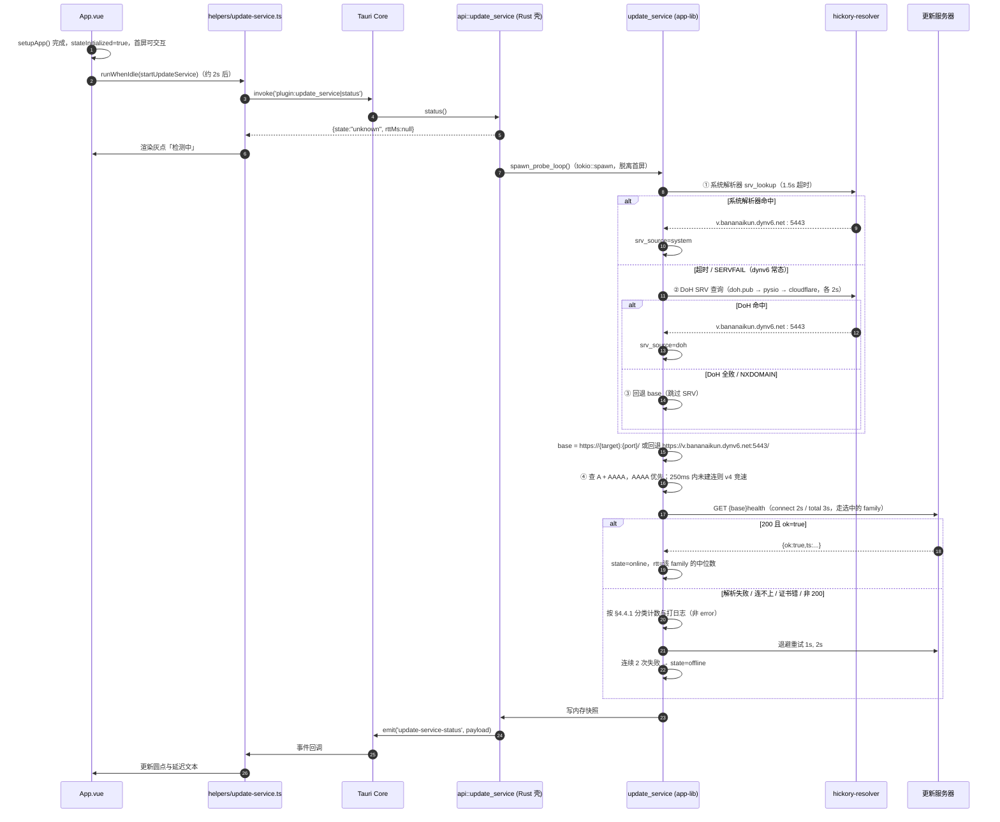
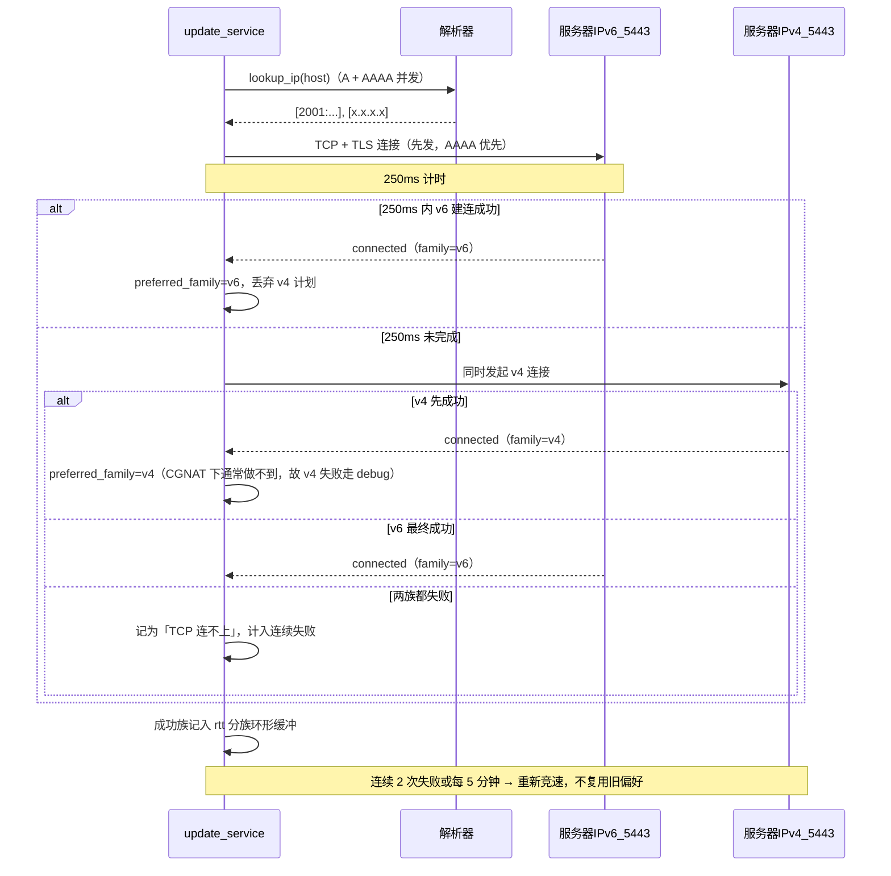
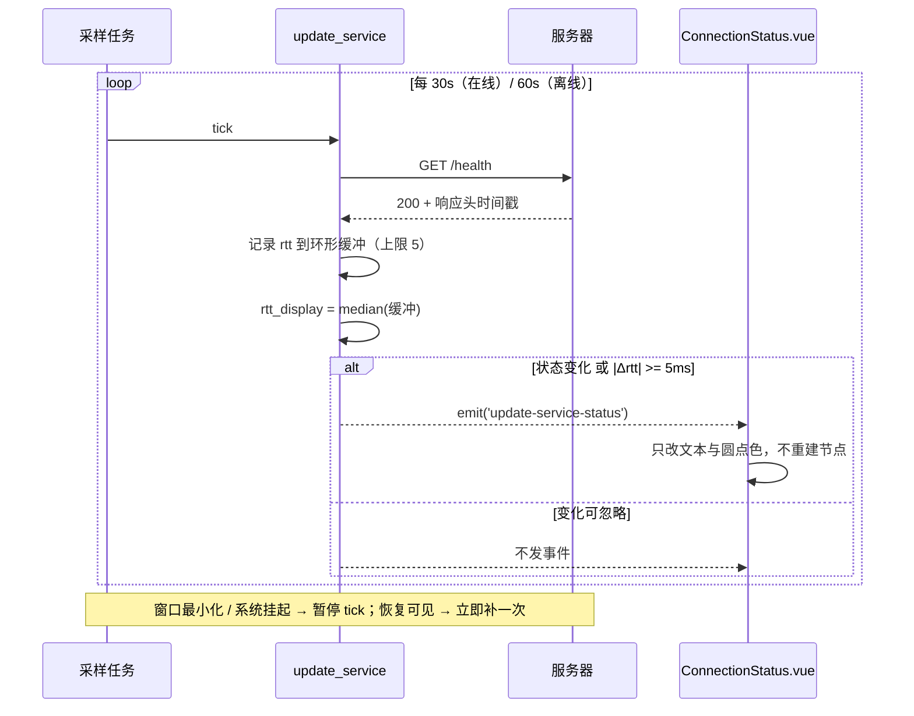
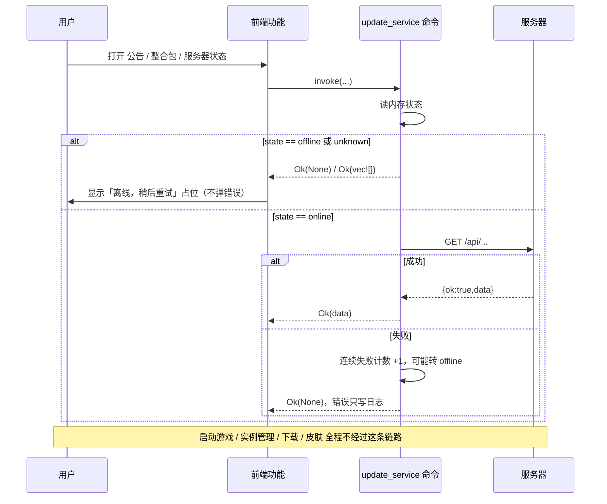
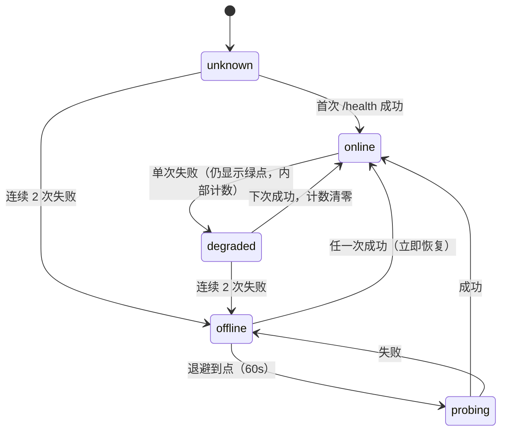
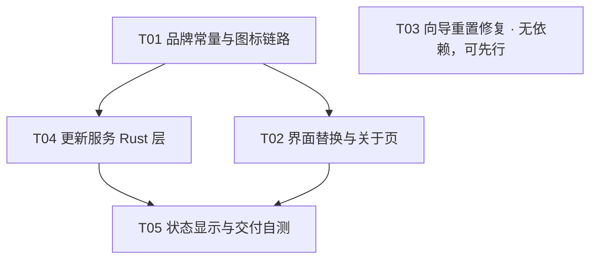

# HaYenai 品牌清零与更新服务 · 架构设计

- 日期：2026-10-17
- 范围：P0-1 品牌残留、P0-2 图标圆角、P0-3 关于页、P0-4 向导重置、P1 更新服务
- 性质：只做设计与分解，不含实现代码
- 相对路径基准：`D:\mod\HaYenai\HaYenai-启动器\`

---

## 0. 结论摘要

| 问题 | 决策 | 一句话理由 |
| --- | --- | --- |
| 更新服务跑在哪一侧 | **Tauri Rust 侧**（app-lib 新模块 + `plugin:update_service`） | 前端 `capabilities/plugins.json` 的 `http:default` 是**静态 URL 白名单**，SRV 解析出的主机/端口编译期不可知；Rust 侧没有这道门 |
| SRV 解析放哪层 | **app-lib**（`hickory-resolver` 已在依赖里） | workspace 已有 `hickory-resolver 0.25.2`，`packages/app-lib/src/api/server_address.rs:151` 有可直接照抄的 `srv_lookup` 写法，零新增依赖 |
| SRV 解析要几级 | **三级：系统解析器 → DoH → 回退 base** | 实测本机默认解析器对 dynv6 **超时**，公共 DNS 正常；只做系统解析器等于默认环境 100% 离线 |
| 服务端口 | **5443（实测 SRV 值），base 必须带端口** | `https://v.bananaikun.dynv6.net:5443/`；不得硬编码 443，端口只从 SRV 或回退常量来 |
| IP 协议 | **AAAA 优先 + 250ms 后 IPv4 竞速** | dynv6 动态 DNS，IPv6 为主、CGNAT 下 IPv4 常无回程；只做 v4 等于不可用 |
| 失败分类 | 解析失败 / TCP / 证书 / 非 200 **统一归「离线」**，日志分级不用 `error` | 都是预期的网络现实，不该让用户以为程序坏了 |
| 新增依赖 | **0 个** | `hickory-resolver` / `reqwest` / `tokio` / `serde` 全部已在 workspace |
| 连不上服务器 | 全部远程能力返回 `Ok(None)` / 空数组，**不弹错误框、不阻塞启动** | 本地功能不经过这条链路 |
| 状态显示 | 后台采样 30s + 事件推送，**不逐帧轮询** | 逐帧 invoke 会打爆 IPC，且触发 Vue 重渲染 |
| 图标圆角 | 构建期用一次性脚本生成圆角矩形母版，再 `tauri icon` 派生全尺寸 | 不在运行时做圆角（CSS 圆角对 ICO/ICNS 无效） |
| 向导重置 | **必须先定位根因**（4 个候选假设 + 命令见 §7），不做「猜着改」 | 症状可能来自便携目录漂移、双库通道翻转、patch 被拒、迁移重跑，四种修法完全不同 |

---

## 1. 现状核实（我实际读到的，不是猜测）

| 事实 | 位置 | 对设计的影响 |
| --- | --- | --- |
| `hickory-resolver = "0.25.2"` 已在 workspace，app-lib 已依赖 | `Cargo.toml:61`、`packages/app-lib/Cargo.toml:52` | SRV 不需要装包 |
| 现成 SRV 写法：`TokioResolver::builder_tokio()?.build()` + `srv_lookup("_minecraft._tcp.{host}")` | `packages/app-lib/src/api/server_address.rs:151-153` | 直接复用调用姿势与 NXDOMAIN 判定 |
| 已有 DoH 解析器 `DownloadDnsResolver`（含 doom.pub / cloudflare 内置列表、5 分钟缓存、失败缓存） | `packages/app-lib/src/util/download_dns.rs` | 更新服务的 DNS 缓存策略照此口径，不另发明 |
| 更新器已换过品牌头：`X-HaYenai-Channel` / `-Platform` / `-Version` | `apps/app/src/updater_impl.rs:203-206` | 契约延续，不推翻 |
| 更新服务地址目前是**常量**：`UPDATE_SERVER_LATEST_URL/API/BASE = https://update.hayenai.local/...` | `apps/app/src/updater_impl.rs:16-18` | 要改成「运行时解析 SRV → 拼 base」，常量退为回退值 |
| 更新目录契约已存在：`{versions:[{version, artifacts:[{kind,variant,platform,architecture,relative_path,sha256,size}]}]}` | `scripts/axolotl/create-update-server-catalog.mjs`、`updater_impl.rs:52-70` | **新端点在 `/api/` 下并行新增，不改既有字段** |
| `tauri.conf.json` 的 `bundle.icon` 引用了 `icons/AxolotlAssets.car`，但该文件**不存在** | `apps/app/tauri.conf.json:21` | 悬空引用，macOS 打包会失败，顺手清掉 |
| 前端 `website` 仍指向上游站点 `https://www.axlmc.org/` | `apps/app-frontend/src/config.ts:6` | 品牌残留（P0-1） |
| 品牌常量对象叫 `AxolotlBrandConfig`，被 **7 个消费文件**引用（`App.vue`、`AboutSettings.vue`、`pages/Settings.vue`、`ErrorModal.vue`、`UpdateAnnouncementModal.vue`、`UpdateAnnouncementHistory.vue`、`MinecraftAuthErrorModal.vue`） | 同上，定义在 `:3` | 命名残留；改名是一次机械替换，但涉及 40+ 处引用点，必须靠 `typecheck` 兜底 |
| `hayenai.png`（512×512，395KB）**已存在**于前端 assets，且 `apps/app/icons/icon.png` 与它同尺寸同体积；该文件目前**未入库**（`git status` 显示为未跟踪） | `apps/app-frontend/src/assets/hayenai.png` | 图标只需替换内容，引用路径可不动；但要先确认它是圆形版还是方形版 |
| 启动动画用 `@/assets/axolotl.png` + 渐变 + 立方体背景 | `SplashScreen.vue:8,109-139` | 换图 + 换背景即可，不必重写组件 |
| 标题栏结构：`statusbar` 行 → 左（logo + beta 徽标 + 前进后退 + 面包屑）→ 右（`AppActionBar` + `WindowControls`），整行 `data-tauri-drag-region` | `App.vue:3106-3142` | 状态指示插在 `AppActionBar` 左侧，**必须不吃拖拽区** |
| `decorations: false`（自绘标题栏） | `apps/app/tauri.conf.json:93` | 新增节点若覆盖拖拽区，窗口拖不动 |
| `WindowControls` 用 `expanded-button` 类，无第三方逻辑 | `WindowControls.vue` | 不动机布局体系，只在 App.vue 插入兄弟节点 |
| 关于页已用 `AxolotlBrandConfig` 拼 LICENSE / COPYING / 第三方许可链接；有彩蛋入口（`EasterEggGameModal`、`EasterEggContributorsModal`）与 `AboutScene` 异步场景 | `AboutSettings.vue:29-41,344,612-613` | 关于页要重写：换品牌、加「二次修改版」声明、去彩蛋 |
| 彩蛋与吉祥物资产体积：`AboutAxolotlRun.vue` 2169 行 + `AboutMergeGame.vue` 1111 行 + `AboutScene.vue` 433 行，配 `axolotl-run/`（23 个文件）、`axolotl-balls/`、两个 axo SVG | `apps/app-frontend/src/components/ui/`、`assets/` | 移除可减小前端包和启动期解析量，但要单独立项提交以便回滚 |
| `packages/assets/branding/axolotl.png` / `axolotl.svg` 被 `apps/website` 共用 | `apps/website/nuxt.config.ts:25`、`AxolotlWordmark.vue` | **不能删**（网站保留上游署名） |
| `scripts/axolotl/brand-guard.mjs` 校验上游不变量：`productName === 'Axolotl Launcher'`、`identifier === 'red.ghs.axolotl'`、scheme `axolotl`、UA `garbage-human-studio/axolotl/...` | `scripts/axolotl/brand-guard.mjs:56-74` | **改名后这个守卫现在必然红**，必须先改写，否则任何「品牌改动」都过不了自检 |
| 设置写入路径：前端 `update()` → `plugin:settings\|settings_patch` → `settings::patch` → `merge_settings` + 单事务 UPDATE | `helpers/settings.ts:342`、`apps/app/src/api/settings.rs:41`、`apps/app-lib/src/api/settings.rs:46-68` | 未知字段/类型不符会整体回滚；写失败即「向导重复弹」的直接嫌疑 |
| 存在**双数据库通道**：`<settings>/app.db`（release）与 `<settings>/beta/app.db`（beta） | `packages/app-lib/src/state/db.rs:113-176` | 通道判定抖动 = 每次启动读到另一份库 |
| 便携模式判据：exe 同目录存在 `.HaYenai` 目录 → `THESEUS_CONFIG_DIR` 指向它 | `apps/app/src/portable.rs:3-41` | 在 `target/release/` 下跑 exe 时，**数据库住在构建产物目录里** |
| 向导显示判据只有一个字段：`showOnboarding = !onboarded` | `App.vue:1551` | 修复应改成版本号判定，单点收口 |
| `finishOnboarding` 写 `{onboarded:true, onboarding_version:1}`，无 try/catch | `App.vue:1655-1680` | 写失败时静默，用户看到的是「关了但下次还弹」 |

**已实测的线上事实（2026-10-17，由主人验证）**

| 事实 | 值 | 对设计的影响 |
| --- | --- | --- |
| SRV 记录存在且可解析（用公共 DNS `223.5.5.5` 查） | `_hayenai-update._tcp.v.bananaikun.dynv6.net` → `v.bananaikun.dynv6.net` : **5443**（priority 10 / weight 0） | base URL 必须带 `:5443`；**不得硬编码 443** |
| **本机默认解析器对 dynv6 会超时**，公共 DNS 正常 | — | 「解析失败」是**常态**而不是异常：`TokioResolver::builder_tokio()` 走系统解析器，会踩这个坑 ⇒ 必须有 DoH 兜底，否则默认环境下永远 offline |
| 动态 DNS，**IPv6 为主**（CGNAT 环境，IPv4 多半没有公网回程） | — | 连接必须 AAAA 优先；IPv4 只作兜底，不能当主路径 |

---

### 1.1 工作区现状（重要：本设计叠加在未提交的改名之上）

| 事实 | 含义 |
| --- | --- |
| 工作区有 **170 个已修改未提交**文件，改动目前只到字符串级（`Axolotl` → `HaYenai` 的 `alt` / `aria-label` / 产品名文案） | 品牌清零是**半成品**：文本换了，**图形资源与组件命名还没换** |
| `apps/app-frontend/src/assets/hayenai.png`、`图标/` 目录为**未跟踪**新文件 | 新图标还没进版本库，覆盖前先确认来源与形状 |
| `SplashScreen.vue` 仍引 `@/assets/axolotl.png`（只有 `alt` 改了） | 启动动画的图**没换**，仍是上游吉祥物 |
| `AxolotlLogo.vue` 仍从 `@modrinth/assets` 引 axolotl 图（只有 `aria-label`/文字改了） | 标题栏与向导页仍显示上游吉祥物 |

结论：本文的任务清单是**增量**，不是重做。开工前先 `git stash` 或先提交这批字符串改动，避免与图形改动混在同一个 diff 里（混了就分不清哪些是「换字」哪些是「换图」）。

---

## 2. 实现方案与取舍

### 2.1 品牌清零：三层收口

不清零单个字符串，而是把「品牌」压成三个可审计的层：

| 层 | 内容 | 做法 | 判据 |
| --- | --- | --- | --- |
| L1 常量层 | 产品名、站点、仓库、UA、bundle id、deep-link、SRV 域名 | 只允许 `packages/app-lib/src/brand.rs` 与 `apps/app-frontend/src/config.ts` 两处出现字面量 | 全仓 `grep` 品牌字面量，命中处只在这两个文件 |
| L2 组件层 | logo 组件、启动动画、标题栏、关于页、向导 | 组件改名（`AxolotlLogo` → `AppLogo`），资源统一指向 `assets/hayenai.png` | 组件名与 `alt` 里不含 axolotl |
| L3 资源层 | PNG/SVG/ICO/ICNS/彩蛋游戏资源 | 圆角矩形母版派生全尺寸；彩蛋资源整目录删除 | 打包产物里不存在 axolotl 品牌图片 |

**分类规则（关键，避免误删）**

| 命中形态 | 归属 | 处理 |
| --- | --- | --- |
| 品牌吉祥物（`axolotl.png`、`axolotl-run/`、`axolotl-balls/`、`axo-searching.svg`、`axo-teaching.svg`、`AxolotlLogo.vue`、`AboutAxolotlRun.vue`） | 品牌残留 | 替换或删除 |
| Minecraft 生物「美西螈」（`lab/recipe-generator/assets/vanilla/*`、multiplayer 房间图标、skin 预览） | 游戏数据 | **不动**（动了下游配方/皮肤就错） |
| 上游署名与许可（`LICENSE`、`COPYING.md`、`apps/website/*`、`packages/assets/branding/*`、`data/about/team.json` 的贡献者） | GPL 溯源 | **不动**；`team.json` 只追加 HaYenai 维护者 |
| 运行时内部标识（localStorage 键 `axolotl:dismissed-download-notification-v1`、数据目录后缀环境变量 `AXOLOTL_DATA_DIR_SUFFIX`） | 用户不可见 / 改名有迁移成本 | **保留**，只在代码注释标注历史原因 |

> `AXOLOTL_DATA_DIR_SUFFIX` 改名会连带改数据目录 → 老用户设置全丢。**不改**，写进本文件「已知保留项」。

### 2.2 图标：圆角矩形，不是圆形

现状：`图标/hayenai-round-1024.png` 是**圆形**；用户要「轻微圆角的方形」。

链路（一次性，产物入库）：

```
图标/123IMG_...png（3273×3273 方形母版）
  → scripts/brand/render-app-icon.ps1（裁方 + 内缩 + 圆角矩形遮罩）
  → apps/app-frontend/src/assets/hayenai.png（512×512，替换现有文件）
  → pnpm exec tauri icon apps/app-frontend/src/assets/hayenai.png --output apps/app/icons
  → apps/app/icons/{icon.png,icon.ico,icon.icns,128x128.png,...}
```

参数与判据：

| 项 | 值 | 理由 |
| --- | --- | --- |
| 形状 | 圆角矩形，圆角半径 ≈ 边长 20%（可微调，以画布确认稿为准） | macOS 观感是圆角矩形，不是圆形；20% 比纯圆(50%)温和 |
| 内缩 | 8%~10% 透明边距 | 全出血图标在任务栏里显得比别的应用大一圈 |
| 抗锯齿 | 由 GDI+ `GraphicsPath` + `SmoothingMode.AntiAlias` 保证 | 免引入 sharp/ImageMagick 依赖 |
| 生成工具 | PowerShell `System.Drawing`（Windows 自带 .NET） | 零依赖、可重复执行 |
| 校验 | 生成后肉眼比对 16×16 与 256×256 两档 | 圆角在小尺寸会糊成圆点，需人工判定 |

### 2.3 关于页文案（P0-3）

```
HaYenai 启动器                     <版本号>
基于 Axolotl Launcher 二次修改版
上游项目：https://github.com/Mystic-Stars/Axolotl
本项目源码：https://github.com/Bananaikun/HaYenai
许可：GPL-3.0-only（含上游版权声明，见 LICENSE / COPYING.md）
外观与品牌由 HaYenai 替换；上游功能与控件布局保留。
```

规则：

1. 「二次修改版」这五个字必须在首屏可见（不折叠、不进弹窗）。
2. 上游链接、LICENSE、COPYING、第三方许可四个入口全部保留。
3. `team.json` 里上游贡献者全部保留（GPL 溯源 + 事实致谢），末尾追加 HaYenai 维护者。
4. 彩蛋入口（键盘触发 + 贡献者弹窗 + 小游戏）删除；删除后 `scripts/axolotl/check-orphan-components.mjs` 必须仍通过。

### 2.4 向导重置（P0-4）：先定位，再修

不预设根因。四个候选按可能性排序，定位命令见 §7。

| # | 假设 | 症状吻合度 | 若是它，修法 |
| --- | --- | --- | --- |
| H1 | **便携目录漂移**：在 `target/release/` 下运行，exe 同目录有 `.HaYenai` → 数据库住在构建目录，重编/清理即丢 | 高（每次重编都复现） | 不把数据目录放进产物目录；启动日志打印实际 DB 路径；「关于 → 诊断」显示路径 |
| H2 | **双库通道翻转**：release 库写成功，下次以 beta 打开另一份库 | 中 | 通道判定在启动时解析一次并缓存，`settings_patch` 不再每次重解析 |
| H3 | **patch 被拒**：`merge_settings` 对未知字段/类型不符整体回滚，前端未捕获 | 中 | 前端 `finishOnboarding` 加 try/catch，失败必须可见；契约测试覆盖 `onboarded`/`onboarding_version` |
| H4 | **迁移重跑**：`reconcile_colliding_java_discovery_migration` 反复 ALTER / 行被重建 | 低 | 修迁移的幂等判定，补 `pragma_table_info` 断言测试 |

与根因无关、必须一并做的三件事：

1. `finishOnboarding` 只有 `updateSettings` 成功才 `showOnboarding=false`；失败弹一次「设置未保存」并写日志（禁止假成功）。
2. 启动判定从 `!onboarded` 收口为 `onboarding_version < CURRENT_ONBOARDING_VERSION`（单一判据，未来升版本有路可走）。
3. 增加一条回归测试：写入 `onboarded/onboarding_version` 后重新 `get()`，断言两次读取一致。

### 2.5 更新服务：为什么必须放 Rust 侧

| 维度 | 前端 fetch（`@tauri-apps/plugin-http`） | Rust 侧（app-lib + 自有 plugin） | 结论 |
| --- | --- | --- | --- |
| 动态主机 | `capabilities/plugins.json` 的 `http:default` 是**静态 URL 白名单**，SRV 解析出的 `host:port` 编译期未知 → 只能放开 `https://*.dynv6.net/*`（过宽）或写死 | 无白名单限制 | **Rust** |
| DNS | 走 WebView2 系统 DNS，dynv6 在国内可能解不出；项目已有 DoH 基建用不上 | 可复用 `hickory-resolver` + DoH 口径 | **Rust** |
| 延迟测量 | fetch 拿不到分段耗时，受 CORS/缓存干扰 | 可量 connect→首字节 | **Rust** |
| 后台采样 | 依赖 webview 存活，最小化/挂起时行为不可控 | `tokio::spawn` 独立 | **Rust** |
| 启动阻塞 | 与首屏同线程，容易拖慢 | 首屏之后 idle 起任务 | **Rust** |
| 前端工作量 | 少 | 一个 TS 封装层 | 平 |

**混合策略**：Rust 负责「解析 + 探测 + 采样 + 缓存 + 事件」，前端只做「订阅 + 渲染」。前端永不直连更新服务器。

### 2.6 架构落位

```
apps/app-frontend
  helpers/update-service.ts        ← invoke + 事件订阅
  components/ui/ConnectionStatus.vue
  App.vue（标题栏插入节点、idle 启动采样）
        │  invoke('plugin:update_service|...')  /  listen('update-service-status')
        ▼
apps/app/src/api/update_service.rs ← Tauri 插件壳：命令 + 事件转发（薄）
        │
        ▼
packages/app-lib/src/api/update_service.rs ← 真正的逻辑：SRV/base/health/状态机/采样
        │
        ├── hickory_resolver（已有）
        └── reqwest（已有，独立小 client）
```

---

## 3. 文件清单

图例：🆕 新增 / ✏️ 修改 / 🗑 删除 / ⚠️ 高风险（涉及构建、许可或数据）

### 3.1 常量与配置

| # | 路径 | 动作 | 改什么 |
| --- | --- | --- | --- |
| 1 | `packages/app-lib/src/brand.rs` | ✏️ | 新增 `UPDATE_SERVICE_SRV` / `UPDATE_SERVICE_FALLBACK_BASE` / `HEALTH_PATH` 常量与注释 |
| 2 | `apps/app-frontend/src/config.ts` | ✏️ ⚠️ | `website` 改掉上游站点；`AxolotlBrandConfig` 改名 `BrandConfig` |
| 3 | `apps/app/tauri.conf.json` | ✏️ ⚠️ | 移除不存在的 `icons/AxolotlAssets.car`；确认 `icon` 列表指向重生成后的文件 |
| 4 | `apps/app/tauri-release.conf.json` | ✏️ | `plugins.updater.endpoints` 改为回退地址（运行时以 SRV 为准） |
| 5 | `scripts/axolotl/brand-guard.mjs` | ✏️ ⚠️ | 上游不变量换成 HaYenai 不变量（productName / identifier / scheme / UA）；保留反上游商标与遥测的禁用模式；新增「禁止重新引入 `assets/axolotl.*`」 |

### 3.2 图标与资源

| # | 路径 | 动作 | 改什么 |
| --- | --- | --- | --- |
| 6 | `scripts/brand/render-app-icon.ps1` | 🆕 | 方形母版 → 圆角矩形 1024 PNG（GDI+，零依赖） |
| 7 | `apps/app-frontend/src/assets/hayenai.png` | ✏️ | **同路径替换内容**为圆角矩形 512 版，5 处引用不用改路径 |
| 8 | `apps/app/icons/*`（`icon.png` `icon.ico` `icon.icns` `128x128*` `Square*Logo.png` `StoreLogo.png` `favicon.ico`） | ✏️ ⚠️ | 由 `tauri icon` 统一重生成；生成后跑 `scripts/center-windows-icon.py` 校正 ICO 光学居中 |
| 9 | `apps/app/icons/axolotl-macos.svg` | 🗑 | 无引用，删除（或替换为 `hayenai-macos.svg` 并接回构建） |
| 10 | `apps/app-frontend/src/assets/axolotl.png` | 🗑 | 品牌吉祥物，5 处引用改指向 `hayenai.png` 后删除 |
| 11 | `apps/app-frontend/src/assets/axolotl-run/`（23 文件）、`axolotl-balls/`（6 文件）、`axo-searching.svg`、`axo-teaching.svg` | 🗑 | 彩蛋游戏与提示插画资源，随彩蛋组件一起删 |

### 3.3 界面（P0-1 / P0-2 / P0-3）

| # | 路径 | 动作 | 改什么 |
| --- | --- | --- | --- |
| 12 | `apps/app-frontend/src/components/ui/AxolotlLogo.vue` → `AppLogo.vue` | ✏️ | 改名；`src` 改 `@/assets/hayenai.png`（**不再**从 `@modrinth/assets` 引，避免碰共享包）；2 处引用同步改 |
| 13 | `apps/app-frontend/src/components/ui/SplashScreen.vue` | ✏️ | 换图；渐变底色换成品牌色（`--c-a` 同族）；`cube-bg` 换成静态柔和光晕；加一条 `scale(0.96→1)` 入场动效，**不引入逐帧动画** |
| 14 | `apps/app-frontend/src/components/ui/settings/AboutSettings.vue` | ✏️ ⚠️ | 换 `BrandConfig`；插入「基于 Axolotl Launcher 二次修改版」段落；删彩蛋入口与 `AboutScene`；保留四个许可/上游入口 |
| 15 | `apps/app-frontend/src/components/ui/AboutAxolotlRun.vue`、`AboutMergeGame.vue`、`AboutScene.vue`、`easteregg/`（2 个 Modal） | 🗑 | 上游彩蛋与场景，删除（单独一次提交，便于回滚） |
| 16 | `apps/app-frontend/src/data/about/team.json` | ✏️ | 上游贡献者全保留；末尾追加 HaYenai 维护者条目 |
| 17 | `apps/app-frontend/src/components/ui/AccountsCard.vue:426`、`pages/Settings.vue:507`、`pages/Skins.vue:1322` | ✏️ | 三处 logo 图引用改 `hayenai.png` |

### 3.4 更新服务（P1）

| # | 路径 | 动作 | 改什么 |
| --- | --- | --- | --- |
| 18 | `packages/app-lib/src/api/update_service.rs` | 🆕 | SRV 解析、base 拼接、`/health` 探测、延迟中位数、状态机、退避采样循环 |
| 19 | `packages/app-lib/src/api/mod.rs` | ✏️ | 挂载 `update_service` 模块 |
| 20 | `apps/app/src/api/update_service.rs` | 🆕 | Tauri 插件：`status` / `refresh` / `base_url` 三个命令 + 状态事件 |
| 21 | `apps/app/src/main.rs` | ✏️ | `.plugin(api::update_service::init())`；窗口 `show` 之后 spawn 采样（与 `runWhenIdle` 同语义） |
| 22 | `apps/app/src/updater_impl.rs` | ✏️ ⚠️ | `update_endpoint()` 从常量改为「SRV base + `/latest`」，取不到时回落常量；离线时**快速失败**而不是等 15 分钟下载超时 |
| 23 | `apps/app-frontend/src/helpers/update-service.ts` | 🆕 | invoke 封装、事件订阅去重、`ref` 状态导出 |
| 24 | `apps/app-frontend/src/components/ui/ConnectionStatus.vue` | 🆕 | 圆点 + `123 ms` 文本 + tooltip（服务器地址 / 最近成功时间）；`text-[11px]` 静态节点 |
| 25 | `apps/app-frontend/src/App.vue` | ✏️ ⚠️ | 标题栏 `AppActionBar` 左侧插入 `<ConnectionStatus />`（**不带** `data-tauri-drag-region`，外层给 `pointer-events-auto`）；`onMounted` 的 `runWhenIdle` 里启动订阅 |
| 26 | `apps/app/capabilities/plugins.json` | ✏️ | 只加 `update_service:default`（自有插件默认权限），**不需要**开放任何 `http:` 域名 |

### 3.5 文档与自测

| # | 路径 | 动作 | 改什么 |
| --- | --- | --- | --- |
| 27 | `docs/architecture/2026-10-17-rebrand-and-update-service.md` | 🆕 | 本文件 |
| 28 | `scripts/dev/update-service-stub.mjs` | 🆕 | 本地假服务器：`/health` `/api/announcements` `/api/versions`，用于无网自测 |
| 29 | `apps/app-frontend/src/components/ui/onboarding/OnboardingWelcome.vue` | ✏️ | `AxolotlLogo` → `AppLogo`（向导页也露吉祥物） |

**新增依赖**：无。**许可影响**：无（不引入新 crate / npm 包）。**体积影响**：删除彩蛋资源约减少前端静态资源数 MB 级（待实测），新增一个图标文件与一个 < 300 行的 Rust 模块。

---

## 4. 更新服务接口契约（草案）

### 4.1 SRV 记录与解析

**实测记录（2026-10-17，公共 DNS 223.5.5.5 查询）**

| 字段 | 实测值 |
| --- | --- |
| 记录名 | `_hayenai-update._tcp.v.bananaikun.dynv6.net` |
| target | `v.bananaikun.dynv6.net` |
| port | **5443** |
| priority / weight | 10 / 0 |

**三级解析（必须三级，缺一级就在国内网络常态失联）**

| 级 | 手段 | 超时 | 失败后 |
| --- | --- | --- | --- |
| 1 | 系统解析器：`TokioResolver::builder_tokio()?.build()` + `srv_lookup(...)`（照抄 `server_address.rs:151`） | 1.5s | 下探 DoH |
| 2 | DoH：复用 `download_dns.rs` 的 `BUILTIN_DOH_SERVERS`（doh.pub → doh.pysio.online → cloudflare），手搓 `Message`/`Query`，`RecordType::SRV` | 每个 2s | 下一个 DoH，全败则跳过 SRV |
| 3 | 回退 base（§4.2），跳过 SRV | — | 直接进连接阶段 |

> 为什么必须做 DoH：主人实测**本机默认解析器对 dynv6 超时**，公共 DNS 正常。只写系统解析器的版本在默认环境下会 100% offline —— 这不是边缘情况，是主路径。
> 零新增依赖：`hickory_resolver::proto::{op::{Message,Query}, rr::{Name,RData,RecordType}}` 已在 `download_dns.rs:1-13` 使用过，DoH POST 也是同一套。
> 已核实：`Cargo.lock` 里 `hickory-resolver 0.25.2` 的依赖只有 `hickory-proto / tokio / moka / rand / resolv-conf`，**没有 rustls、没有 h2** ⇒ 它的 DoH feature 未启用，不能靠 `Resolver::builder_with_config + Protocol::Https` 一行搞定。**只能手搓 DoH POST**——这正是 `download_dns.rs` 走的路，已有可运行先例。
> **并行而非串行**：第 1 级与第 2 级的第一个 DoH（`doh.pub`，国内最快）同时发起，谁先返回用谁。串行最坏 1.5s + 2s×3 = 7.5s，第一屏的灰点会亮得太晚。

**选择规则**

| 规则 | 说明 |
| --- | --- |
| 排序 | `(priority asc, weight desc, target asc)` 取第一个；**不做随机加权**，便于日志复现 |
| 多记录轮询 | 同优先级同权重存在多条时，按 target 顺序轮换（每次成功换下一个） |
| target | 去尾部 `.`；`target == "."` ⇒ 服务明确不可用（RFC 2782 语义），直接 offline，不重试 SRV |
| port | `0` ⇒ 不可用；其余原样用于 base URL |
| 缓存（成功） | 300s；**DoH 命中同样缓存**（否则每次探测白付 2s） |
| 缓存（失败） | 30s（与 `download_dns.rs` 的 `FAILURE_CACHE_TTL` 一致） |
| 记录日志字段 | `srv_source=system\|doh\|fallback`、`target`、`port`、`elapsed_ms`，便于线上区分「是 DNS 慢还是服务慢」 |

### 4.2 base URL 拼接

```
有 SRV:    https://{target}:{port}/                    ← 当前即 https://v.bananaikun.dynv6.net:5443/
无 SRV:    https://v.bananaikun.dynv6.net:5443/        ← brand.rs 回退常量，与当前部署一致
调试覆盖:  HAYENAI_UPDATE_BASE（优先级最高，仅本地/CI 用，不读设置项）
```

端口规则与实例：

| 情形 | 拼接结果 | 说明 |
| --- | --- | --- |
| SRV 给 `:5443` | `https://v.bananaikun.dynv6.net:5443/` | **当前实际形态**，端口必须保留 |
| SRV 给 `:443` | `https://v.bananaikun.dynv6.net/` | 只有 443 才省略 |
| SRV 给 `:0` 或 `target="."` | 无 base → offline | 不拼 URL |
| 无 SRV | `https://v.bananaikun.dynv6.net:5443/` | 回退常量，**同样带 5443** |
| `HAYENAI_UPDATE_BASE=https://127.0.0.1:8787/` | 原样使用 | 本地桩服务器，必须允许非 443 |

规则：

1. **不得硬编码 443，也不得把 5443 写死在拼接逻辑里** —— 端口只从 SRV 或回退常量来；换端口只改 DNS，不改代码。
2. base 必须以 `/` 结尾，端点用相对路径拼（`base + "health"`），避免双斜杠。
3. 覆盖值同样跑一遍 URL 解析校验，非法则忽略并记日志，**不因此进入 offline**。
4. 不做「http 回退」——降级安全性不划算；证书不过就当离线，不降级明文。
5. 证书校验**严格**（`rustls` 默认根证书 + 主机名校验），反代若用自签证书必须在部署侧解决，客户端不开后门。

### 4.3 端点表

| 端点 | 方法 | 用途 | 超时 | 失败降级 | 响应体（新端点统一包裹） |
| --- | --- | --- | --- | --- | --- |
| `/health` | GET | 存活 + 延迟测量 | connect 2s / total 3s | → offline 判定 | `{"ok":true,"ts":<unix>,"minLauncher":"0.1.0"}` |
| `/api/versions` | GET | 更新目录（**既有，字段不变**） | 8s | 返回空目录 | `{"versions":[...]}`（沿用现有结构） |
| `/latest` | GET | tauri updater 端点（**既有**） | 插件默认 | 忽略本次检查 | updater 清单 |
| `/api/announcements` | GET | 公告 | 6s | `[]` | `{"ok":true,"data":[{"id","title","body","level":"info" / "warn" / "critical","publishedAt","dismissible"}]}` |
| `/api/mods` | GET | 模组增删弹窗 | 6s | `[]` | `{"ok":true,"data":[{"id","name","action":"add" / "remove","reason","mandatory"}]}` |
| `/api/modpacks` | GET | 整合包一键安装清单 | 6s | `[]` | `{"ok":true,"data":[{"id","name","version","url","sha256","size"}]}` |
| `/api/server-status` | GET | 服务器状态 | 6s | `null` | `{"ok":true,"data":{"online":true,"players":0,"max":0,"motd":"","latencyMs":0}}` |
| `/api/auth/session` | POST | 玩家身份认证（登录信息换会话） | 6s | `null` | `{"ok":true,"data":{"player":"","uuid":"","expiresAt":0}}` |

约定：

1. 新端点全部 `{"ok":bool,"data":...}`；`ok:false` 时带 `error:{code,message}`，**不改变 HTTP 200**（便于弱网代理透传），但 4xx/5xx 一律按失败处理。
2. `/api/versions` 与 `/latest` **保持原结构**，因为它由 `scripts/axolotl/create-update-server-catalog.mjs` / `create-update-manifest.mjs` 生成，改结构等于改发布链。
3. 三个请求头沿用现有更新器写法：`X-HaYenai-Channel`、`X-HaYenai-Platform`、`X-HaYenai-Version`。
4. `/api/auth/session` 只发「登录票据」，不发明文密码；返回会话只存内存，不落库。

### 4.4 超时 / 退避 / 离线判定

| 参数 | 值 | 说明 |
| --- | --- | --- |
| 探测间隔（在线） | 30s | 前台窗口可见时 |
| 探测间隔（离线） | 60s | 省流量、省电 |
| 退避序列 | 1s → 2s → 4s → 8s → 16s → 30s（上限） | 抖动 ±20%，避免多机同拍 |
| 进入 offline | **连续 2 次**失败 | 单次失败不改状态（防抖动） |
| 恢复 online | 1 次成功 | 立即恢复，不等确认 |
| 延迟取值 | 最近 5 次成功的**中位数** | 抗单次尖刺 |
| 首次探测时机 | 首屏 `stateInitialized` 之后 + 2s idle | **绝不**挡启动 |
| 窗口最小化 / 系统挂起 | 暂停采样 | 恢复可见时立刻探一次 |
| 单次探测总超时 | HTTP 部分 3s（connect 2s + 首字节 1s） | 超过即计失败 |
| DNS 预算 | 2.5s（系统解析与 `doh.pub` 并行，谁先到用谁） | 单次探测总预算 ≈ 5.5s，只在最坏情况出现 |

#### 4.4.1 四类失败 → 同一个「离线」态，不同日志级别

对用户只有三种显示：`在线 / 离线 / 检测中`。**四类失败在 UI 上无差别**，差别只在日志与 tooltip 的「最后原因」。

| # | 失败类别 | 识别方式 | 是否计入连续失败 | 日志级别 | 备注 |
| --- | --- | --- | --- | --- | --- |
| 1 | **SRV 解析失败**（系统解析器超时 / SERVFAIL） | `hickory` resolve error | 计入（DoH 也全败时） | `debug`；进程生命周期内首次 `warn` 一次 | 本机解析器对 dynv6 超时是**常态**，不是异常；已下探 DoH，DoH 成功则本次不算失败 |
| 1b | SRV 无记录（NXDOMAIN） | `is_no_records_found()` | **不计入** | `debug` | 预期分支：走回退 base，不是故障 |
| 2 | **TCP 连不上**（refused / host unreachable / 连接超时） | reqwest `Error::is_connect()` | 计入 | `debug` | 服务没起或 IPv6 不可达，属常见；不重试超过退避序列 |
| 3 | **证书不受信**（签发链 / 主机名不匹配 / 过期） | rustls `InvalidCertificate` 类 | 计入 | **`warn`**，同一 host 30 分钟限频一次 | 这是**部署配置问题**，必须有人看见；但限频避免刷满日志 |
| 4 | **非 200** | `status != 200` | 计入 | 5xx → `warn`；4xx → `debug` | 5xx 是服务端故障；4xx 是客户端契约错，日志里带响应体前 200 字节 |
| 5 | 200 但 `ok:false` | JSON 字段 | **不计入**（连通性正常） | `debug` | 在线判定只看可达性，业务失败不算离线 |

规则：

1. **不使用 `error` 级别**处理以上任何一类 —— 它们都是「预期的网络现实」，不该让用户或日志读者以为程序坏了。
2. 限频器：内存 `HashMap<(host, kind), last_warn_at>`，同类同 host 10~30 分钟内只 `warn` 一次。
3. tooltip 展示「最后原因」的**分类名**（如「证书不受信」），不展示原始错误串（长度不可控、含本地路径）。
4. 每次状态切换写一条 `info`：`update_service: online -> offline (reason=cert, base=https://…:5443)`，便于按时间线复盘。

#### 4.4.2 双栈连接策略（IPv6 优先）

dynv6 是动态 DNS，本项目部署以 IPv6 为主（CGNAT 环境，IPv4 多半没有公网回程）。**只做 IPv4 等于默认不可用。**

| 环节 | 策略 |
| --- | --- |
| 解析 | 同时请求 A 与 AAAA（`lookup_ip`），两族都拿到再决策，别串行等 |
| 连接顺序 | **AAAA 优先**：先发起 IPv6 连接，250ms 内未完成则同时发起 IPv4（Happy Eyeballs 简化版），先成功者胜 |
| 实现方式 | 用 `reqwest::ClientBuilder::resolve()` 把域名钉到指定 IP，建 v6/v4 两个 client，`tokio::select!` 竞速；TLS SNI 仍用 URL 主机名，证书校验不受影响 |
| 记忆 | 记住 `preferred_family`（成功的那一族），后续探测直接用它；连续 2 次失败或每 5 分钟重新竞速一次 |
| 日志 | 每条探测日志带 `family=v6\|v4` 与 `addr=2001:...`，否则线上分不清「服务慢」还是「v6 掉线」 |
| 延迟统计 | **按 family 分开统计**，两族 RTT 不可混算；切换 family 时显示 `--`，直到该族攒够 2 个样本 |
| CGNAT 现实 | IPv4 失败按 `debug` 处理，**不要连试 3 次**——它可能压根没有回程，试也是白试 |

### 4.5 前端 IPC 契约

| 名称 | 类型 | 载荷 |
| --- | --- | --- |
| `plugin:update_service\|status` | 命令 | → `{state:"unknown"\|"online"\|"offline", rttMs:number\|null, baseUrl:string\|null, lastOkAt:number\|null}`，**立即返回内存快照，不发网络请求** |
| `plugin:update_service\|refresh` | 命令 | → 同上，触发一次立即探测（前端手动重试按钮用），不等待网络完成 |
| `plugin:update_service\|base_url` | 命令 | → `string\|null`，给更新器与调试面板用 |
| `update-service-status` | 事件 | 载荷同上，仅在状态变化或延迟变化 ≥5ms 时发 |

约定：**所有远程业务命令在 offline 时返回 `Ok(None)` / `Ok(vec![])`，错误只写日志（target `theseus::update_service`），不冒泡成对话框。**

---

## 5. 调用时序

### 5.1 启动 + 首次探测（不阻塞首屏）



#### 5.1.1 双栈建连（IPv6 优先 + 250ms 后 IPv4 竞速）



### 5.2 延迟采样节拍（不逐帧）



### 5.3 失败降级（离线仍全功能）



### 5.4 状态机



---

## 6. 任务列表（5 个任务组，组内按序执行）

依赖图：



> T03 与前四者无代码依赖，可并行；建议**先做 T03**，因为它是用户每天都会遇到的痛点。

### T01 品牌常量收口 + 图标圆角链路

**源文件**：`packages/app-lib/src/brand.rs`、`apps/app-frontend/src/config.ts`、`scripts/brand/render-app-icon.ps1`(新)、`apps/app-frontend/src/assets/hayenai.png`、`apps/app/icons/*`、`apps/app/tauri.conf.json`、`scripts/axolotl/brand-guard.mjs`

| 步 | 动作 | 验收判据 | 离线可测 |
| --- | --- | --- | --- |
| 1 | `config.ts` 去掉上游站点、`AxolotlBrandConfig`→`BrandConfig`（7 个消费文件、40+ 处引用机械替换） | `grep -rn "axlmc.org\|AxolotlBrandConfig" apps packages` 无命中；`pnpm run typecheck` 绿 | ✅ |
| 2 | `brand.rs` 增 SRV / 回退 base / health path 常量 | `cargo clippy -p theseus` 绿；`cargo test -p theseus brand` 绿 | ✅ |
| 3 | 写 `render-app-icon.ps1`，从方形母版生成 512 圆角 PNG，覆盖 `assets/hayenai.png` | 生成图非圆（四角可见圆角矩形轮廓）、8~10% 内缩、透明背景；16/256 两档肉眼可辨 | ✅ |
| 4 | `pnpm exec tauri icon ... --output icons` 重生成；按需跑 `center-windows-icon.py` | `icons/icon.ico` 打开后任务栏不偏左；`icons/` 内无 axolotl 命名残留 | ✅ |
| 5 | 删 `tauri.conf.json` 里 `icons/AxolotlAssets.car` 悬空引用；删 `icons/axolotl-macos.svg` | `pnpm run build` 通过；`grep -rn "AxolotlAssets" apps` 无命中 | ✅ |
| 6 | 改写 `brand-guard.mjs`：HaYenai 不变量 + 保留反上游商标/遥测禁用模式 + 新增「禁止 `assets/axolotl.` 引用」 | `pnpm run axolotl:brand-guard` 输出 `HaYenai brand guard passed.` | ✅ |

### T02 界面替换（启动动画 / 标题栏 logo / 关于页 / 彩蛋清理）

**源文件**：`AppLogo.vue`(改名)、`SplashScreen.vue`、`App.vue`、`OnboardingWelcome.vue`、`AboutSettings.vue`、`team.json`、`AccountsCard.vue`、`pages/Settings.vue`、`pages/Skins.vue`、`AboutAxolotlRun.vue`(删)、`AboutMergeGame.vue`(删)、`AboutScene.vue`(删)、`easteregg/*`(删)、`assets/axolotl.png`(删)、`assets/axolotl-run|axolotl-balls|axo-*.svg`(删)

| 步 | 动作 | 验收判据 | 离线可测 |
| --- | --- | --- | --- |
| 1 | `AxolotlLogo.vue` → `AppLogo.vue`，改引 `@/assets/hayenai.png`；2 处引用同步 | 标题栏左上角显示新图标，无 axolotl 图 | ✅ 需起窗 |
| 2 | `SplashScreen.vue` 换图 + 换背景 + 加一次 scale 入场 | 冷启动首屏出现新图标；无逐帧动画、无新增图片请求 | ✅ |
| 3 | `AboutSettings.vue` 插入「基于 Axolotl Launcher 二次修改版」+ 上游/源码/GPL 链接 | 打开关于页首屏可见该句；LICENSE / COPYING / 第三方许可三个链接可点且地址正确 | ✅ |
| 4 | 删除彩蛋入口、三个 About* 组件、`easteregg/` 两 Modal、彩蛋资源目录 | `pnpm run axolotl:check-orphan-components` 绿；`pnpm run build` 通过；前端产物中无 `axolotl-run` 资源 | ✅ |
| 5 | `team.json` 末尾追加 HaYenai 维护者，上游贡献者条目逐条保留 | 关于页贡献者列表仍含 Mystic Stars 等上游成员 | ✅ |
| 6 | 三处 logo 引用改 `hayenai.png`，删 `assets/axolotl.png` | `grep -rn "assets/axolotl" apps/app-frontend/src` 无命中 | ✅ |

**风险提示**：第 4 步单独一次提交。彩蛋删除若引发 `check-retired-ui` / `settings-search-index.ts` 引用报错，按报错清单补删入口。

### T03 向导重置：定位 + 修复

**源文件**：`App.vue`、`apps/app-frontend/src/helpers/settings.ts`（如需要）、`packages/app-lib/src/api/settings.rs`（如根因为 patch 拒绝）、`packages/app-lib/src/state/db.rs`（如根因为迁移）、`apps/app/src/main.rs`（如需要打印 DB 路径）

| 步 | 动作 | 验收判据 | 离线可测 |
| --- | --- | --- | --- |
| 1 | 按 §7 命令采集现场：数据目录、DB 文件、`settings` 行值、`_sqlx_migrations` | 得到一张「路径 → onboarded 值 → 时间戳」表，能判定是 H1/H2/H3/H4 中的哪一个 | ✅ |
| 2 | 复现：完成向导 → 完全退出 → 再启动 → 看是否弹；并用 `get_current_app_database_path` 比对两次路径 | 两次路径相同 → 排除 H1；不同 → 命中 H1 | ✅ |
| 3 | 修 `finishOnboarding`：写成功才关、失败可见（toast + 日志） | 人为让 `settings_patch` 失败（DevTools 传非法字段），界面出现「设置未保存」且向导不消失 | ✅ |
| 4 | 判定收口为 `onboarding_version < CURRENT` | 源码中只有一处决定 `showOnboarding`；`grep -c "showOnboarding.value = !onboarded"` 为 0 | ✅ |
| 5 | 补回归测试：写入后重新 `get()` 一致；`onboarded` + `onboarding_version` 同时在 patch 白名单内 | `cargo test -p theseus settings` 通过；新增前端 vitest 断言两条读取一致 | ✅ |
| 6 | 若命中 H1/H2，按 §2.4 对应修法落地，并在「关于 → 诊断」显示真实 DB 路径 | 连续三次重启都不再弹向导 | ✅ |

**出口判据**：连续 3 次「完成向导 → 退出 → 重启」不重复弹窗；且第 1 步的现场表归档到 `docs/reports/`。

### T04 更新服务 Rust 层（SRV + 契约 + 状态机）

**源文件**：`packages/app-lib/src/api/update_service.rs`(新)、`packages/app-lib/src/api/mod.rs`、`apps/app/src/api/update_service.rs`(新)、`apps/app/src/main.rs`、`apps/app/src/updater_impl.rs`、`apps/app/capabilities/plugins.json`、`apps/app/tauri-release.conf.json`

| 步 | 动作 | 验收判据 | 离线可测 |
| --- | --- | --- | --- |
| 1 | app-lib 写 SRV 三级解析（系统 → DoH → 回退）+ base 拼接 + 缓存（纯函数可单测） | 单测覆盖：系统命中 / 系统超时后 DoH 命中 / DoH 全败回退 / NXDOMAIN / `target="."` / `port=0` / `port=5443` / `port=443` / env 覆盖 九种输入；`srv_source` 字段有值 | ✅ 纯单测 |
| 2 | 写 `/health` 探测 + 双栈竞速（AAAA 优先，250ms 后 v4）+ 延迟分族中位数 + 状态机（连续 2 次失败转 offline） | 单测/桩覆盖：v6 通→online(family=v6)、v6 不通 v4 通→online(family=v4)、两族都断→2 次后 offline、恢复 1 次→online；日志带 `family` 与 `addr` | ✅ 用桩 |
| 3 | 写失败分类与日志限频（§4.4.1 六类，禁止 `error` 级别） | 桩分别注入：DNS 超时 / 连接拒绝 / 自签证书 / 500 / 404 / `ok:false`，日志级别与计数符合表格；同类 10 分钟内只 warn 一次 | ✅ 用桩 |
| 4 | 写采样循环（30s/60s、退避、最小化暂停钩子、5 分钟重竞速） | 起窗后 60s 内看到 ≥2 次探测日志；最小化后日志停止；5 分钟后再次出现竞速日志 | 需起窗 + 桩服务器 |
| 5 | Tauri 插件壳：`status` / `refresh` / `base_url` + 事件；`main.rs` 注册并在窗口 show 后 spawn | `invoke` 三个命令返回结构正确的载荷；事件名与契约一致 | ✅ 用桩 |
| 6 | `updater_impl.rs`：endpoint 改为「SRV base + `/latest`」，离线快速失败 | 桩服务器关闭时「检查更新」1~3s 内返回失败而不是挂 15 分钟；打开时能读到 `/latest` | ✅ 用桩 |
| 7 | `capabilities/plugins.json` 加 `update_service:default`；确认**未**开放任何 `http:` 域名 | `capabilities` 里无 hayenai/dynv6 域名条目；前端类型检查通过 | ✅ |
| 8 | 真机联调（唯一需要外网的步骤） | 本机默认 DNS 下（不设任何环境变量）能 online，日志 `srv_source=system` 或 `doh`；`curl -6 https://v.bananaikun.dynv6.net:5443/health` 与启动器结论一致 | ❌ 需真实网络 |

### T05 状态显示 + 交付自测

**源文件**：`apps/app-frontend/src/helpers/update-service.ts`(新)、`components/ui/ConnectionStatus.vue`(新)、`App.vue`、`scripts/dev/update-service-stub.mjs`(新)、`docs/architecture/2026-10-17-rebrand-and-update-service.md`

| 步 | 动作 | 验收判据 | 离线可测 |
| --- | --- | --- | --- |
| 1 | 写 `helpers/update-service.ts`：invoke 封装、事件订阅只注册一次、卸载时退订 | 反复进入/离开页面不叠加监听（DevTools 里 `listeners` 不增长） | ✅ |
| 2 | 写 `ConnectionStatus.vue`：圆点（绿/灰/红）+ `123 ms` + tooltip（地址、最近成功） | 三种状态各有可视差异；tooltip 含 base URL | ✅ 用桩切换 |
| 3 | `App.vue` 标题栏 `AppActionBar` 左侧插入；节点**不带** `data-tauri-drag-region`，容器 `pointer-events-auto` | 拖动标题栏空白处窗口能移动；点击状态点不触发拖拽；`WindowControls` 位置与尺寸不变 | ✅ 需起窗 |
| 4 | `App.vue` 在 `runWhenIdle` 里启动订阅（与 `checkUpdates` 同批） | 首屏可交互后再出现「检测中」；首屏时间无可感知变化 | ✅ |
| 5 | 写 `scripts/dev/update-service-stub.mjs`：`/health`、`/api/announcements`、`/api/versions`，支持 `--port 5443`、`--delay`、`--status 503`、`--tls-selfsigned` 四种模式 | `HAYENAI_UPDATE_BASE=https://127.0.0.1:5443/ node scripts/dev/update-service-stub.mjs` 后启动器显示在线与真实延迟；`--tls-selfsigned` 下转离线且日志级别为 `warn`（证书类） | ✅ |
| 6 | 断网全量冒烟：关掉桩 → 重启 → 逐一打开所有依赖远程的界面 | 无错误弹窗、无长时间 loading、本地功能（启动游戏/实例/下载）全部可用；状态点转红，延迟显示 `--` | ✅ |

**T05 出口判据**：桩服务器三种模式（正常 / 延迟 800ms / 直接 503）下，状态点在 90 秒内正确收敛；断网时启动时间与联网时差异无可测变化（连续 3 次冷启动，极差内）。

---

## 7. 风险与待确认项

### 7.1 必须先用命令定位的（不要猜）

| # | 待确认 | 定位命令 | 判据 |
| --- | --- | --- | --- |
| R1 | 向导重置根因 | `Get-ChildItem "$env:APPDATA" -Directory \| Where-Object Name -like "com.hayenai*"`；`Get-ChildItem . -Recurse -Filter app.db \| Select FullName,LastWriteTime,Length` | 出现两份 `app.db`（含 `beta/`）→ H2；只有一份但位于 `target\release\.HaYenai\` → H1 |
| R2 | 设置是否真的写进去了 | `sqlite3 <db> "select onboarded, onboarding_version, onboarding_instance_tour_completed from settings;"` | 值为 1/1/1 但下次仍弹 → 读到的是另一份库（H1/H2）；值为 0 → 写入未生效（H3/H4） |
| R3 | 迁移是否反复执行 | `sqlite3 <db> "select version,description,success from _sqlx_migrations order by version desc limit 8;"`；日志搜 `Reconciled colliding` | 同一描述多次出现或 `success=0` → H4 |
| R4 | patch 是否被拒 | DevTools 执行 `await window.__TAURI__.core.invoke('plugin:settings\|settings_patch',{patch:{onboarded:true}})` | 抛错 → H3；返回 settings 且值变化 → 排除 H3 |
| R5 | SRV 记录是否已生效 | `nslookup -type=SRV _hayenai-update._tcp.v.bananaikun.dynv6.net 223.5.5.5`；再不带服务器参数跑一次对比 | 带公共 DNS 有结果、默认解析器超时 ⇒ DoH 兜底是必需项（已按此设计） |
| R6 | 上游 pubkey 是否可换 | 读 `tauri-release.conf.json` 的 `plugins.updater.pubkey` | **不可换**：换密钥 = 所有老客户端装不上新包，必须沿用现有 pubkey |
| R7 | `:5443` 的证书是谁签的、覆盖哪个域名 | `curl -v --max-time 8 https://v.bananaikun.dynv6.net:5443/health`；或 `openssl s_client -connect v.bananaikun.dynv6.net:5443 -servername v.bananaikun.dynv6.net` | 证书链受信 + SAN 含 `v.bananaikun.dynv6.net` ⇒ 可用；自签/不匹配 ⇒ **所有客户端永久离线**，必须在服务端换证书 |
| R8 | `:5443` 在常见网络下是否被放行 | `Test-NetConnection v.bananaikun.dynv6.net -Port 5443`（Windows）；移动热点下再测一次 | 公司/校园/公共 WiFi 常封非标端口；若大面积不通，需在文档写明「换网络或走代理」 |
| R9 | IPv6 是否真的可达（CGNAT 关键） | `curl -6 --max-time 8 -sv https://v.bananaikun.dynv6.net:5443/health`；`curl -4` 同样跑一次 | v6 通、v4 不通是预期形态 ⇒ 必须 AAAA 优先；两者都不通先别写代码，先修部署 |

### 7.2 设计风险

| # | 风险 | 影响 | 缓解 |
| --- | --- | --- | --- |
| R10 | 标题栏新节点吃掉 `data-tauri-drag-region` | 窗口拖不动（用户第一时间会骂） | 组件根节点不加 drag-region，容器 `pointer-events-auto`；T05 步 3 专门验 |
| R11 | 延迟文本导致高频重渲染 | 内存/CPU 反向劣化（和项目目标冲突） | 30s 采样 + ≥5ms 才发事件 + 单一文本节点 |
| R12 | 删除 `packages/assets/branding/axolotl.*` | `apps/website` 构建失败 | 明令不动共享包；只删前端私有资源 |
| R13 | 删彩蛋触发 `check-orphan-components` / `check-retired-ui` / i18n 键残留 | 自检红，卡发布 | 删除后立刻跑三个检查脚本，按报告补删引用与 i18n 键 |
| R14 | 圆角图标在 16×16 糊成圆点 | 任务栏辨识度下降 | 生成后必看 16/24/32 三档；必要时小尺寸单独减圆角 |
| R15 | 动态 base URL 与 updater 的编译期 endpoints 冲突 | 更新器仍打占位地址 | `updater_builder().endpoints()` 支持运行时传入（`updater_impl.rs` 已这么做），endpoints 只作回退 |
| R16 | `AXOLOTL_DATA_DIR_SUFFIX` 仍是旧名 | 品牌残留（不可见） | 保留，注释说明；改名需迁移数据目录，收益不抵风险 |
| R17 | 本地构建产物目录里的数据被当正式数据 | 换目录即「设置全丢」 | 便携模式在「关于 → 诊断」显示当前 DB 路径；文档写明不要把 `.HaYenai` 放进 `target/` |
| R18 | `/api/auth/session` 涉及凭据 | 泄露风险 | 只发票据不发密码；会话仅存内存；失败一律 `None`，不重试到成功为止 |
| R19 | DoH 兜底让首次探测变慢（最多 1.5s + 2s×3） | 状态点迟迟不亮，看起来像卡住 | 三级并行化：系统解析与第一个 DoH **同时**发起，谁先到用谁；首个 DoH 用 `doh.pub`（国内快） |
| R20 | 只因 IPv4 不通就判「服务器挂了」 | 误报，掩盖真实可用性 | 状态只看「任一 family 可达」；IPv4 失败一律 `debug`，且在 tooltip 标明当前走 v6 |
| R21 | 非标端口 5443 撞上企业代理白名单 | 部分用户长期离线 | 离线不阻断任何本地功能；tooltip 提示「端口 5443 可能被网络拦截」；必要时后续加 DNS 层 HTTP 反代（不改客户端） |
| R22 | 证书到期（dynv6 + Let's Encrypt 若有自动续期失败） | 全体客户端同时离线 | 上线前确认续期链路；`/health` 返回的 `ts` 与证书 `notAfter` 一起进日志，便于提前发现 |

### 7.3 待主人确认

| # | 问题 | 影响 |
| --- | --- | --- |
| Q1 | 圆角半径最终值（建议 20%，可 18%~22%） | 图标观感，需画布确认 |
| Q2 | 官网/仓库最终地址（`config.ts` 的 `website` 填什么） | 关于页与 UA 文案 |
| Q3 | 彩蛋是否全部删除，还是保留「贡献者名单」作为普通页面 | 决定 T02 步 4 范围 |
| Q4 | 更新服务的公告/模组弹窗是否需要「强制」级别（阻断式） | 决定 `/api/announcements` 是否支持 `mandatory` |
| Q5 | 服务器状态与玩家认证是否复用现有 `terracotta`/`multiplayer` 通道，还是走新端点 | 影响 `/api/server-status` 是否必要 |
| Q6 | `:5443` 用的是什么证书（Let's Encrypt / 自签 / 其他），SAN 是否含 `v.bananaikun.dynv6.net` | 决定「证书不受信」是不是常态；若是自签，必须先解决部署再谈客户端 |
| Q7 | dynv6 的 AAAA 是否稳定（路由器前缀变化时会短暂失联？） | 决定是否需要「IPv6 前缀变更后立即重解析」的额外机制 |
| Q8 | 服务器是否只监听 IPv6（无 IPv4 回程），还是双栈 | 决定 IPv4 兜底是「真兜底」还是「纯形式」 |

---

## 8. 交付顺序建议

1. **T03 先做**（每天都会遇到的痛点，且独立）。
2. T01 → T02（品牌清零是用户最直观的「换皮完成」）。
3. T04 → T05（更新服务是新增能力，最后接）。
4. 每完成一个任务组，跑一次 `pnpm run axolotl:brand-guard` + `pnpm run build`，保证中间态可用。
5. T05 收尾时把桩服务器用法写进 `docs/README.md`，方便下次联调。

---

## 附：构建命令（沿用，不加并发）

```powershell
cd D:\mod\HaYenai\HaYenai-启动器\apps\app
$env:RUST_MIN_STACK = "67108864"
$env:CARGO_BUILD_JOBS = "1"
$env:CARGO_PROFILE_RELEASE_OPT_LEVEL = "0"
$env:CARGO_PROFILE_RELEASE_CODEGEN_UNITS = "256"
$env:JAVA_HOME = "C:\Program Files\Java\jdk-21"
pnpm exec tauri build --config tauri-release.conf.json --no-bundle
# 产物：target/release/HaYenai.exe
```
