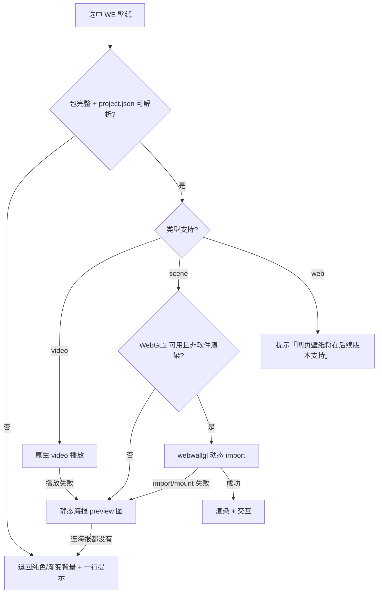
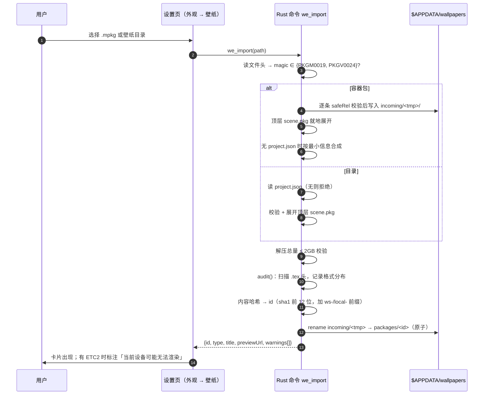
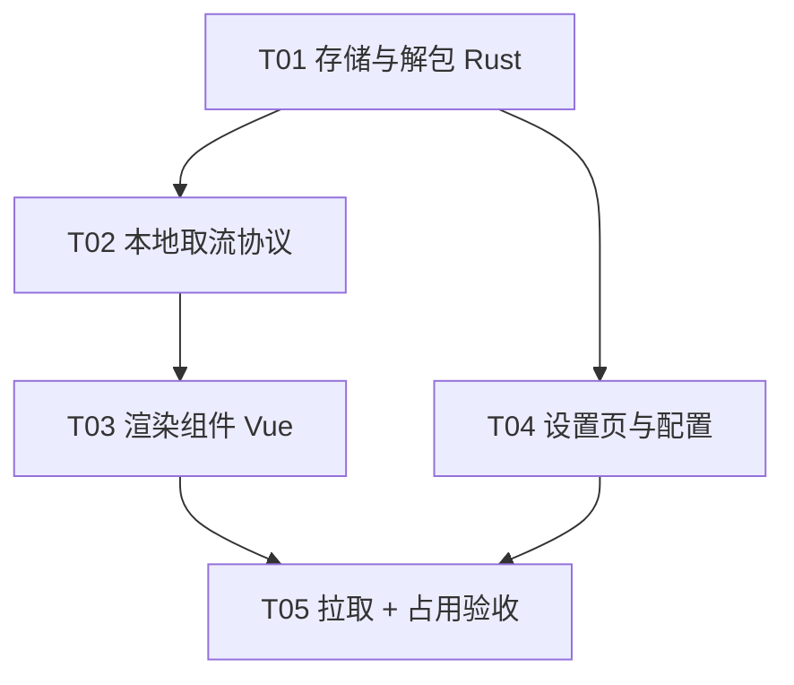

# HaYenai 启动器 · Wallpaper Engine 壁纸支持 · 架构设计

- 日期：2026-10-17
- 范围：WE 壁纸的导入 / 拉取 / 渲染 / 交互 / 占用控制，入口挂在「设置 → 外观」
- 性质：研究 + 设计，不含实现代码
- 依据：`HaYenai-服务器端`（后台管理）与 `HaYenai-桌面端/desktop`（Electron）两处**已上线**的 WE 实现

---

## 0. 结论摘要

| 问题 | 结论 |
| --- | --- |
| 后台管理的实现能不能复用 | **能，而且比预期好**：它不只有下发，**有完整的浏览器端 WebGL 渲染器**（`src/components/bg/WeWallpaper.tsx`），三类壁纸（scene / web / video）都跑得起来 |
| 复用什么 | ① 渲染层 → 直接装 npm 包 `webwallgl`（MIT）；② 交互机制 → 逻辑可直译；③ 取流协议 → 路径形状/缓存/Range 1:1 照搬 |
| 不能复用的是什么 | 服务端的 **Node 解包与 `.tex` 转码**（`we.cjs` / `wetex.cjs`）—— 启动器是 Rust，要用 Rust 重写解包（≈120 行），转码第一期**不做** |
| 第一期做哪几类 | **场景类（scene）+ 视频类（video）**。Web 类推到第二期（iframe 子文档的内存与安全成本与「低占用」硬指标冲突） |
| 交互怎么做 | 视差/拖动 = window 级 `pointermove` → `pushPointer()`（**不能挂 canvas**，背景层是 `pointer-events:none`）；点击穿透本来就已经成立；真正的「桌面壁纸」= 第二个置底窗口，列 v2 |
| 低占用怎么保证 | 默认 30fps + 后处理 medium + AA off + 贴图 0.8 倍率；**不可见即 pause**（不是降帧）；无 GPU 直接不来 WebGL2，退回静态海报 |
| 新增依赖 | 1 个：`webwallgl`（MIT，2.1.0 实测 min 约 1.05 MB，**动态 import**）。零 Rust 新增依赖（解包只用标准库读 u32 LE） |

---

## 1. 现状总结

### 1.1 后台管理（`D:\mod\HaYenai\HaYenai-服务器端`）已实现什么

| 能力 | 文件 | 关键实现 |
| --- | --- | --- |
| `.mpkg` / `.pkg` 解包 | `server/we.cjs:99 parsePkg` | `PKGM0019` 与场景子包 `PKGV0024` **同构**（`magicLen｜magic｜count｜重复(nameLen｜name｜off｜size)`），条目**不压缩**，同一套解析；`safeRel()` 在写盘前挡 zip-slip |
| 目录形态 / `scene.pkg` | `we.cjs:164 expandScenePkgs` | 工坊目录里主场景常是打包的 `scene.pkg`，就地展开成松散目录，否则前端按 `project.file` 取 `scene.json` 会 404 |
| 缺 `project.json` 的场景包 | `we.cjs:188 synthProject` | 只有场景那一半的包按最小信息补一份（title/type/file/preview） |
| 包 id | `we.cjs:321 hashDir` | 目录内容 SHA-1（文件名+字节）；id 里天然带内容哈希 ⇒ 可以吃 immutable 缓存 |
| 元数据 | `we.cjs:366 metaOf` | `{id,type,title,description,tags,workshopId,file,preview,entries,bytes,dir,installedAt,hasProperties}`，`type` 归一化成 scene/video/web/application/other |
| 用户属性表 | `we.cjs:403 propertiesOf` | 把 `project.json.general.properties` 摊平；**同一项有 6 份语言副本**，按 `condition:"language.value == N"` 筛；slider 常不写 min/max ⇒ 缺省 0–1 |
| `.tex` 兼容化 | `server/wetex.cjs`（607 行） | ETC2（format 3/5）→ PNG，原 `.tex` 改名 `.tex.disabled` 让位，渲染器自动回退同名 `.png`；`audit()` 只读文件头出格式清单。实测 3840×2160 一张 ≈ 1.9 s（LZ4 46ms + ETC2 969ms + PNG 830ms），PNG 4.68 MB |
| 取流 | `server/static.cjs:348 servePkg` | `GET /api/we/pkg/[vN/]<id>/<rel>`，`Cache-Control: immutable` + Range |
| 缓存纪元 | `src/lib/api.ts:58 WE_PKG_EPOCH='v2'` | 兼容化是「原地改内容」，URL 不变而字节变 ⇒ 用 `v2` 段换 URL 空间。**纪元只在 URL 里，服务端不解释** |
| 浏览器端渲染 | `src/components/bg/WeWallpaper.tsx`（412 行） | `webwallgl@2.1.0` **动态 import**；`mountTimeoutMs=300s`；`setProperties/setFps/setQuality` 热更不重挂；`pause/resume`；`pushPointer/pointerLeave`；`setAudio`；`onDiagnostic` 接降档原因 |
| 贴图/设备能力检测 | `src/lib/weCompat.ts`（124 行） | 按 `.tex` 格式 × 设备 WebGL 扩展算「这台机器画不画得出来」；贴图倍率只能通过页面 URL 的 `resources` 参数传（`mount` 选项里没有） |
| 失败兜底 | `src/components/Backdrop.tsx:378 wallFallback` | 渲染失败 → 退回内置壁纸（库不自带降级页，这是它的设计） |
| 实测口径 | `desktop/scripts/_probe-we-perf.cjs` | 库有三套自动降质：`autoQuality`（fps 连续 3s < 上限 85% → high→medium→low→off，只降不升）、视频纹理倍率 1→0.5→0.35→0.25、`resourceScaleFor`（`R=max(0.6,min(1,dpr/2))`）；`setOcclusion()` 不调则「遮挡降帧」**休眠** |

### 1.2 桌面端（`HaYenai-桌面端/desktop`，Electron）

同一套 React 实现（`src/components/bg/WeWallpaper.tsx`），外加 **本地 HTTP 服务** `electron/lib/server.cjs`（252 行，其中 147–170 行是 Range：`Accept-Ranges: bytes` / 206 / 416 `Content-Range`）。

> 这说明「渲染器按名逐个取文件」这一形态在两个宿主上都被验证过：一个走远端服务器，一个走本机 HTTP。

### 1.3 启动器（本次目标）现状

| 事实 | 位置 | 影响 |
| --- | --- | --- |
| 背景**只支持图片**（png/jpeg/jpg/webp/gif/avif/bmp） | `AppearanceSettings.vue:641 CUSTOM_BACKGROUND_EXTENSIONS` | 无视频、无 canvas 背景层 |
| 背景层已经是 `position:fixed; inset:-3rem; z-index:0; pointer-events:none` | `App.vue:3696 .launcher-background` | 交互必须走 window 级事件；**和后台完全同一个约束**，所以交互代码可直译 |
| 本地图片经 `convertFileSrc()` 走 asset 协议 | `App.vue:296`、`AppearanceSettings.vue:590` | 已有现成的本地文件喂法 |
| asset 协议 scope 只到 `$APPDATA/backgrounds/*`（单层） | `tauri.conf.json:97` | WE 包有子目录，scope 必须扩成 `wallpapers/**`，或另开协议 |
| CSP `connect-src` **不含** `asset:` / `http://asset.localhost`；`media-src` 也没有任何本地源 | `tauri.conf.json:123`（`devCsp` 与 `csp` **两份**都要改） | 用 `fetch()` 走 asset 协议会被 CSP 挡；`<video>` 更是连媒体类型都没放行 |
| 已有自定义协议先例，且 `frame-src` 已放行它的两种形态：`http://axolotl-skin.localhost`、`axolotl-skin://localhost` | `main.rs:708 register_uri_scheme_protocol("axolotl-skin", …)`、`tauri.conf.json` `frame-src` | 证明 Windows 下自定义协议的 URL 形状就是 `http://<scheme>.localhost`；照这个形状加 `hayenai-we` 即可，**不需要开端口** |
| **没有**通用本地 HTTP 服务 | 只有 OAuth 的临时 listener（`api/oauth_utils/auth_code_reply.rs`） | 要么用自定义协议，要么新起一个 hyper 服务 |
| 窗口 `transparent: true`、`decorations: false` | `tauri.conf.json:93` | 对「视频 + 透明窗」的合成路径有影响，需实测 |
| 启动器 Rust 侧无任何 WE 相关代码 | — | 解包/取流要从零写 |

### 1.4 可复用性结论（直接回答「会不会只做了下发没做渲染」）

**做了渲染，而且是完整的三类通吃渲染器。** 但复用是**分层**的：

| 层 | 能否直接搬 | 说明 |
| --- | --- | --- |
| 渲染（scene/web/video） | ✅ 装包即用 | `webwallgl` 是 MIT 的独立 npm 包，与框架无关（`mount(container, opts)`），Vue 里包一层组件即可 |
| 交互（指针/音频） | ✅ 逻辑直译 | 由于启动器背景层同样 `pointer-events:none`，那段 window 级 `pointermove` 注入可以照搬 |
| 取流协议 | ✅ 形状照搬 | 路径、immutable、Range；宿主换成 Tauri 自定义协议 |
| 解包（PKGM/PKGV） | ⚠ 必须重写 | Node CJS → Rust；格式简单（u32 LE + 裸数据），≈120 行 |
| `.tex` 转码（ETC2→PNG） | ❌ 一期不做 | Rust 侧要重写 ETC2+LZ4+PNG 编码，代价大；**先验证 webwallgl 3.x 是否已修**（见 R2） |
| 工坊拉取（DepotDownloader + 扫码登录） | ❌ 不做 | 需要 WE 正版账号 + Steam 登录，启动器不该碰 |

---

## 2. 三种壁纸类型的能力边界

| 类型 | 渲染方式 | 交互能力 | 独占成本 | 第一期 |
| --- | --- | --- | --- | --- |
| **场景类** `scene` | `webwallgl` → WebGL2；图层/效果/粒子/SceneScript 全在库里 | **完整**：鼠标视差、按住拖动、音频频谱、用户属性滑条 | WebGL2 上下文 + 解码后的贴图常驻显存；一个 22.5MB 包两张主贴图占 20.4MB（磁盘） | ✅ **做**（唯一能提供「WE 原生交互」的类别） |
| **视频类** `video` | **原生 `<video>`**，不进 WebGL | 无（最多 CSS 视差） | 硬解码占用（GPU 视频引擎），不占 JS 堆与显存 | ✅ **做**（成本极低，且比走库更省） |
| **网页类** `web` | `sandbox` iframe（库的 web 分支也是 append iframe） | 有，但由网页自己写脚本 | 一个完整子文档 ⇒ 独立 JS 堆 + 独立渲染；可发网络请求、可存 storage | ⏸ **二期**（与「低占用」硬指标冲突，且安全面大） |
| `application` / `other` | — | — | — | ❌ 直接提示「该类型暂不支持」 |

### 2.1 视频类：为什么不走库

| 方案 | 内存 | 解码 | 代码量 | 结论 |
| --- | --- | --- | --- | --- |
| `<video loop muted playsinline>` | 视频帧走 GPU 视频引擎，不进 JS 堆 | 硬件（Media Foundation / D3D11） | ~20 行 | ✅ 采用 |
| `webwallgl` 的 video 分支 | 多一个 WebGL2 上下文 + 视频纹理上传 | 软件路径可能被选中，还要 `createAdaptiveVideoScale` 动态降倍率 | 要引入 1MB 库 | ❌ 只为播 mp4 不值 |

**WebView2 下视频的四个坑（已确认的机制，落地时要验）**：

1. **自动播放必须先 `muted`**：Chromium 的 autoplay 策略对无声视频放行，有声直接 `play()` 被拒（Promise reject）。壁纸永远静音 ⇒ 加 `muted` 即可。
2. **`preload="auto"` 会预取整片**：WE 视频壁纸动辄几十上百 MB，改成 `preload="metadata"`，靠 `loop` 而不是 JS seek 循环。
3. **绝对不要用 canvas 抽帧做效果**：`drawImage(video)` 会把帧从 GPU 回读到 CPU，帧率腰斩、内存翻倍 —— 这正是「低占用」的反面。
4. **透明窗口下的硬解路径要实测**：`transparent: true` 时 DWM 合成可能让视频掉到软件路径。判据：任务管理器里 GPU「Video Decode」有占用，且 `chrome://gpu`（DevTools）显示硬件解码开启。
5. 附带：`disablePictureInPicture`、`controls=false`、`tabindex=-1` —— 免得用户能右键出「画中画 / 下载」。

### 2.2 场景类：成本评估（决定默认档位）

| 阶段 | 成本 | 依据 |
| --- | --- | --- |
| 首帧 | 要等**整包取完 + 贴图解码 + 着色器编译**，约 1s 量级（本机文件，不是外网隧道） | 后台实测：外网隧道 200KB/s 下 22.5MB 需 110s，才把看门狗放到 300s；本地无此问题 |
| 稳态 | 每帧 GPU 开销 + 后处理 pass；本机实测 50s 内 `autoQuality` 从 high 降到 low（说明默认 high 在本机跑不满 60fps） | `_probe-we-perf.cjs` |
| 显存 | 全屏 RGBA 后处理链 ×N pass；贴图按倍率缩放后常驻 | 后台实测：DPR 1.25 机器上 `R=0.625`，主贴图 1920×609 → 1200×381，显存 12.5→17.2MB |
| CPU | 默认 60fps 的 rAF 循环 + SceneScript | — |

**结论**：启动器默认档位必须比后台更保守（30fps / medium / AA off / 0.8 倍率），见 §4。

---

## 3. 交互性怎么做

### 3.1 三个诉求拆开看

| 诉求 | 机制 | 一期 |
| --- | --- | --- |
| 鼠标视差 / 跟随 | window `pointermove` → 归一化到容器坐标 → `inst.pushPointer(u, v, buttons, mods)` | ✅ |
| 点击反馈 | 不注入 `pointerdown/up`；用 `buttons` 位表示「按住拖动」 | ✅（仅拖动） |
| 点击穿透（壁纸不挡 UI） | 背景层 `pointer-events: none`（**已经成立**，无需改） | ✅ 天然满足 |
| 真正的桌面壁纸（在主窗之外） | 第二个 Tauri 窗口置底 + `set_ignore_cursor_events(true)` | ⏸ v2 |

### 3.2 为什么不能挂 canvas

后台踩过、启动器会遇到同一个问题：

> 引擎默认从**场景 canvas** 上听 `mousemove`，而背景层必须 `pointer-events: none`（否则铺满视口的背景会吃掉整个界面的点击）⇒ 引擎一个事件都收不到 ⇒ 鼠标交互完全失效。

所以：**从 `window` 收事件，按容器 `getBoundingClientRect()` 归一化后推给引擎**。三件事必须做全：

| 细节 | 理由 |
| --- | --- |
| 只挂 `pointermove` | 它自带 `buttons`，「按住拖动」天然是按下态 |
| **不补** `pointerdown/up` | 否则点界面上的按钮也会在壁纸上炸一下冲量（`g_PointerState.z`） |
| `blur` + `document.mouseleave` 时 `pointerLeave()` | 鼠标移出窗口后松手收不到 `mouseup`，不重置会让按键永久卡在按下态 |

### 3.3 一期明确「不做点击反馈」的原因

启动器界面几乎**没有**未被 UI 覆盖的背景区域（侧栏 + 内容区 + 标题栏铺满），点击永远落在 UI 上。把 UI 点击透传给壁纸 = 用户每点一次按钮壁纸就抽一下，是负体验。

**真要做「点一下壁纸有反应」，只有 v2 的第二窗口方案才成立**（那时壁纸窗口在桌面层，点它不点 UI）。

### 3.4 v2：真·桌面壁纸窗口（只做设计留口，不实现）

| 项 | 方案 | 风险 |
| --- | --- | --- |
| 窗口层级 | 新建无边框窗口，`always_on_bottom`（或 z-order 压到主窗之下）+ `set_ignore_cursor_events(true)` 全穿透 | Windows 上「始终置底」不可靠：会被「显示桌面」、全屏应用、UAC 桌面切换影响 |
| 交互 | 穿透后收不到鼠标 ⇒ 只能由**主窗口**转发指针位置（需要屏幕坐标换算） | 坐标换算 + 多显示器 DPI |
| 成本 | **第二个 WebView2 进程**（独立渲染进程与 JS 堆） | 与「低占用」冲突，必须可关 |
| 多显示器 | 每屏一个窗口 | 每个窗口一份 WebGL2 上下文 |

一期必须为 v2 留的口：渲染组件**只依赖传入的 container 元素与事件源**，不读全局 router / themeStore；指针源做成可替换的参数（`window` / 转发事件）。

### 3.5 失败退路（逐级降，不允许黑屏）



---

## 4. 资源占用控制

**口径**：全部按 `docs/协作规范.md` §7 —— 渲染态、静置 30s、三次冷启动、`WorkingSetPrivate`（主进程 + WebView2 子进程）、Δ 必须大于三次极差才算「测出」。

### 4.1 默认档位与可测判据

| # | 项 | 默认值 | 可测判据 |
| --- | --- | --- | --- |
| 1 | 帧率上限 | **30**（不是库默认 60） | 60s 内 `requestAnimationFrame` 计数 1800 ±5% |
| 2 | 后处理 | **medium**（不是 high） | 60s 内库 `onDiagnostic` 无降档记录（`autoQuality` 没触发） |
| 3 | 抗锯齿 | **off** | 同上 |
| 4 | 贴图倍率 | **0.8**（不是 native） | 日志里贴图实际尺寸 = 原尺寸 ×0.8 ±1px |
| 5 | 不可见 → 暂停 | `blur` / `minimize` / `visibilitychange=hidden` → `inst.pause()` | 切后台 5s 内 rAF 计数**不再增长**（不是降到 24fps，是 0） |
| 6 | 恢复 → 续跑 | 可见时 `resume()`（幂等） | 切回 1s 内 rAF 继续，画面不冻在最后一帧 |
| 7 | 音频注入 | **默认关闭** | 不创建 `AudioContext`（DevTools → Memory 里 0 个；不注入则库用内置模拟源，壁纸照样动） |
| 8 | 视频 `preload` | `metadata` | 选中后 3s 内网络/磁盘读取量 < 全片 10% |
| 9 | 视频不可见 | `pause()` | 后台 5s 内 `currentTime` 不变 |
| 10 | 无 GPU → 不建上下文 | `getContext('webgl2', {failIfMajorPerformanceCaveat:true})` 失败即走海报 | 强制软件渲染启动时，DOM 里无 `<canvas>`，只有海报 `` |
| 11 | 首屏不阻塞 | 壁纸在 `stateInitialized` 之后、idle 时加载 | 首屏到可交互时间与「壁纸=纯色」相比 Δ 在极差内 |
| 12 | 内存 | 见 4.2 | Δ > 三次极差才下结论，否则写「测不出」 |

### 4.2 内存预算（第一期只给口径，不给假数字）

| 场景 | 组成 | 目标 |
| --- | --- | --- |
| 关壁纸（基线） | 主进程 + WebView2 | 记录基线，作为对照 |
| 视频壁纸 | 硬解码帧不进 JS 堆 | 增量主要来自视频缓冲，量级 待标定 |
| 场景壁纸（0.8 倍率 / 30fps / medium） | WebGL2 上下文 + 贴图 + 后处理 FBO | **上限 待标定**，首次在目标机器测完基线后写死数字 |
| 场景壁纸（native / 60fps / high） | 同上 ×2~3 | 不提供为默认；若提供需在 UI 标注「高占用」 |

> 不在文档里编 MB 数。`待标定` 的填法：同一台机器、同一窗口尺寸、同一张包，测「关壁纸 / 视频 / 场景」三态各三次冷启动，取均值与极差，把 Δ 与上限写回本表。

### 4.3 三个「省不了」的实话

1. **场景壁纸一定比纯色贵**：2200 万像素的图层合成 + 后处理，怎么调都比静态图贵。低占用能保证的是「不可见时趋近于 0」「默认档位可用而不卡」，不是「和纯色一样省」。
2. **贴图解码那一下是硬成本**：20MB 的两张 4K 贴图解码进显存，第一次约 1s；重挂时靠库内缓存，本组件换包即销毁（`releasePkgCache: true`）—— 这是后台的取舍，启动器沿用（换包不常发生）。
3. **视频的省电来自硬解**：如果实测掉进软件解码，占用会反超场景类；那时应该**关掉视频壁纸**而不是硬撑（写进验证报告）。

---

## 5. 导入与拉取

### 5.1 落盘布局

```
$APPDATA/<identifier>/wallpapers/
├─ packages/
│  └─ <id>/                     # 松散目录形态（与后台完全一致）
│     ├─ project.json
│     ├─ scene.json  |  materials/  shaders/  ...
│     └─ preview.jpg
├─ incoming/                    # 导入暂存，成功即清空
├─ config.json                  # 选中项 + 属性覆盖 + 档位（原子写）
└─ posters/<id>.jpg             # 海报（= 包内 preview 的副本，给「过渡/回退」用）
```

**为什么配置放 `config.json` 而不是 settings 表**（重要取舍）：

| 方案 | 代价 |
| --- | --- |
| 加 `settings` 表字段 | `state/settings.rs` 的 UPDATE 是 **50 个位置参数**（`:660-770`），加字段要同步改 SELECT 列、UPDATE 的 `$N` 编号、bind 顺序三处；本项目的向导 bug 就出在这条链上（见另一份设计 §2.4 H3） |
| **独立 `config.json`（采用）** | 与设置系统解耦，原子写（临时文件 + rename）；代价：不随「设置导出/备份」走，需在文档说明 |

### 5.2 导入流程



### 5.3 校验清单（全部在写盘前）

| # | 检查 | 不通过的处理 |
| --- | --- | --- |
| 1 | `magic ∈ {PKGM0019, PKGV0024}` | 拒绝：「不是 Wallpaper Engine 壁纸包」 |
| 2 | 条目名 `safeRel`（禁 `..` / 绝对路径 / 空段 / 盘符） | 拒绝：「包里含有不安全的路径」 |
| 3 | 解压总量 ≤ 2 GB | 拒绝（防磁盘炸） |
| 4 | 必须有 `project.json`（或可由场景包合成） | 拒绝：「找不到 project.json」 |
| 5 | `project.json` 是合法 JSON | 拒绝，带解析错误位置 |
| 6 | `type ∈ {scene, video, web, application}` | 导入但标「暂不支持」，不渲染 |
| 7 | `file` 指向的文件真实存在 | 标损坏 |
| 8 | sha256/size（仅服务端拉取时） | 下载失败即丢弃 |

### 5.4 从服务端拉取（沿用后台形态，标出缺口）

| 端点 | 现状 | 说明 |
| --- | --- | --- |
| `GET /api/we/pkg/[vN/]<id>/<rel>` | ✅ **已有** | 取流 1:1 复用；`v2` 纪元段照抄（URL 里保留、服务端会忽略） |
| `GET /api/we/catalog` | ❌ **缺** | 后台只有本地 `list()`，没有对外 JSON 目录。需新增：`{items:[{id,name,type,tags,previewUrl,sizeBytes,sha256,texAudit:{etc2:bool,bc7:bool}}]}` |
| `GET /api/we/manifest/<id>` | ❌ **缺** | 预检用：下 22MB 之前先知道「能不能在这台机器上渲染」。字段同上 + `files[]`（可选，用于增量） |
| `POST /api/we/feedback` | 可选 | 渲染失败上报，便于发现坏包 |

**一期降级策略**（服务端没就绪也不挡路）：

1. 有 `catalog` → 显示远程壁纸库，可下载。
2. 只有 `pkg` 取流 → 支持「粘贴 id / 链接」直接拉。
3. 都没有 / 离线 → 只显示本地已导入的包；一张都没有 → 保持现有图片背景或纯色。

下载走已有下载器（带 sha256 校验 + 落盘），下完复用 §5.2 的解包路径 —— **导入与拉取共用同一条装配流水线**，不要写两份。

### 5.5 离线与失效

| 情况 | 表现 |
| --- | --- |
| 服务端不可达 | 远程列表显示「离线，仅本地可用」，本地包照常用 |
| 包文件被用户手动删了 | 下次启动检测 `packages/<id>` 不存在 → 从 config 里剔除，退纯色，不报错弹窗 |
| 包损坏（`project.json` 坏） | 卡片标红「损坏」，可一键删除 |
| WebGL2 不可用 | 走静态海报（§3.5） |

---

## 6. 文件清单与任务分解

### 6.1 文件清单

**Rust（启动器）**

| # | 路径 | 动作 | 改什么 |
| --- | --- | --- | --- |
| 1 | `packages/app-lib/src/api/wallpaper/mod.rs` | 🆕 | 模块入口：类型定义（`WallpaperMeta`/`WallpaperType`/`TexAudit`）、错误类型 |
| 2 | `packages/app-lib/src/api/wallpaper/pkg.rs` | 🆕 | PKGM0019 / PKGV0024 解析（u32 LE + 裸数据）、`safe_rel`、解包落盘、`scene.pkg` 展开、`project.json` 合成 |
| 3 | `packages/app-lib/src/api/wallpaper/store.rs` | 🆕 | `wallpapers/` 目录布局、id 哈希（sha1 前 12）、list/get/remove、原子 rename、`config.json` 读写 |
| 4 | `packages/app-lib/src/api/wallpaper/tex_audit.rs` | 🆕 | 只读 `.tex` 头（`TEXV0005` + format 字段），产出格式分布；**不转码** |
| 5 | `apps/app/src/api/wallpaper.rs` | 🆕 | Tauri 插件：`we_list` / `we_import` / `we_remove` / `we_select` / `we_config_get` / `we_config_set` |
| 6 | `apps/app/src/we_protocol.rs` | 🆕 | 自定义协议 `hayenai-we`：路径解析、`safeRel`、MIME、`immutable` + ETag、**Range（206/416）** |
| 7 | `apps/app/src/main.rs` | ✏️ | 注册 `hayenai-we` 协议（照 `:708` 的 `axolotl-skin` 写法）+ 注册插件 |
| 8 | `apps/app/tauri.conf.json` | ✏️ ⚠️ | CSP **两处**（`devCsp` 与 `csp`）都加 `http://hayenai-we.localhost`：`connect-src`、`img-src`、`media-src`、`frame-src`。注意 `media-src` 现在是 `'self' data: https://*.githubusercontent.com`，不加就播不了视频 |
| 9 | `packages/app-lib/Cargo.toml` / `Cargo.toml` | ✏️ | 如 Range/哈希需 `sha1_smol`（**已有**）则无需新增；确认零新增 |

**前端（Vue）**

| # | 路径 | 动作 | 改什么 |
| --- | --- | --- | --- |
| 10 | `apps/app-frontend/src/components/background/WeWallpaper.vue` | 🆕 | 包 `webwallgl`：动态 import、容器 div、poster 过渡、档位热更、pause/resume、指针注入、失败回调 |
| 11 | `apps/app-frontend/src/components/background/VideoWallpaper.vue` | 🆕 | 原生 `<video>`：`loop muted playsinline preload=metadata`、不可见 pause |
| 12 | `apps/app-frontend/src/components/background/WallpaperLayer.vue` | 🆕 | 统一层：按类型分派、失败降级链（§3.5）、接管 `.launcher-background` 的位置与样式 |
| 13 | `apps/app-frontend/src/helpers/wallpaper.ts` | 🆕 | invoke 封装、`hayenai-we` base URL 生成、config 读写、类型定义 |
| 14 | `apps/app-frontend/src/components/ui/settings/WallpaperSettings.vue` | 🆕 | 「设置 → 外观 → 壁纸」：导入按钮、卡片列表、属性面板、档位选择、删除 |
| 15 | `apps/app-frontend/src/components/ui/settings/AppearanceSettings.vue` | ✏️ | 挂载新 section（**不推翻现有布局**，只加一块 `SettingsSection`） |
| 16 | `apps/app-frontend/src/App.vue` | ✏️ ⚠️ | `launcher-background` 内部改为 `<WallpaperLayer>`；保留 `pointer-events:none` |
| 17 | `apps/app-frontend/package.json` | ✏️ | `webwallgl`（MIT，**锁 2.x 具体小版本**，见 R1） |

**文档/验证**

| # | 路径 | 动作 |
| --- | --- | --- |
| 18 | `docs/architecture/2026-10-17-wallpaper-engine.md` | 🆕 本文件 |
| 19 | `docs/reports/wallpaper-perf-<date>.md` | 🆕 占用测量报告（按协作规范 §7 模板） |
| 20 | `scripts/spike-we-3x.html` | 🆕 单页 spike：验证 webwallgl 3.x 的 ETC2/API 差异（跑完可删） |
| 21 | `THIRD_PARTY_NOTICES.md` | ✏️ 增 `webwallgl` 条目（MIT，含版本与用途） |

**新增依赖评估**

| 依赖 | 版本 | 许可 | 体积 | 四问结论 |
| --- | --- | --- | --- | --- |
| `webwallgl` | 锁 `2.1.0`（或验证后的 3.x） | **MIT**（npm registry 确认，仓库 `oneincase/webwallgl`） | 2.1.0 实测 min ≈ **1.05 MB**，3.0.0 待标定 | ① 标准库做不了（WebGL2 场景渲染器）② 无替代（唯一开源的 WE scene 渲染器）③ 动态 import，仅选 WE 壁纸时才加载 ④ MIT 与 GPL-3.0 兼容 |

### 6.2 任务列表（5 组，组内按序）



#### T01 壁纸存储与解包（Rust，纯离线）

**源文件**：`wallpaper/{mod,pkg,store,tex_audit}.rs`、`apps/app/src/api/wallpaper.rs`、`main.rs`（注册插件）

| 步 | 动作 | 验收判据 | 离线可测 |
| --- | --- | --- | --- |
| 1 | 写 PKGM0019/PKGV0024 解析 + `safe_rel` | 单测：合法包、magic 错、长度不足、`..` 路径、绝对路径、超 2GB 六种输入各有断言；用真实 `.mpkg` 样本解出的条目数与 `bytes` 与后台 `we.cjs` 一致（逐条比对） | ✅ |
| 2 | 写 `store`：布局、原子 rename、id 哈希、list/remove | 同一包二次导入 → 同 id、不重复占盘；删除后目录消失；`config.json` 写到一半被杀进程不产生半个文件（临时文件 + rename） | ✅ |
| 3 | 写 `tex_audit`：只读头，统计格式 | 对 ETC2 样本报 `etc2:true`，对 DXT5 样本报 `dxt5:true`；读取量 < 4KB/文件（不整文件读） | ✅ |
| 4 | 导入命令端到端（目录形态 + 容器形态 + `scene.pkg` 展开 + `project.json` 合成） | 四种输入（.mpkg / 仅场景 .pkg / 松散目录 / 工坊目录带 scene.pkg）都能装成功并 list 出正确 type | ✅ |
| 5 | 错误路径不给用户看堆栈 | 每一类失败都有中文单句提示 | ✅ |

#### T02 本地取流协议（Rust，纯离线）

**源文件**：`apps/app/src/we_protocol.rs`、`main.rs`、`tauri.conf.json`（CSP）

| 步 | 动作 | 验收判据 | 离线可测 |
| --- | --- | --- | --- |
| 1 | 实现 `hayenai-we://` 幂等映射：`/<id>/<rel>` | `fetch('http://hayenai-we.localhost/<id>/project.json')` 返回 200 + 正确 JSON | ✅ 起窗 |
| 2 | 路径穿越防护 | `GET /<id>/../../secret`、`%2e%2e%2f`、绝对路径、盘符 全部 400/403，且不读到 wallpapers 外的任何文件 | ✅ |
| 3 | MIME + 缓存头 | `.tex→application/octet-stream`、`.json→application/json`、`.mp4→video/mp4`、`.png→image/png`；响应带 `Cache-Control: immutable` 与 `ETag`，二次请求走 304 | ✅ |
| 4 | **Range** | `Range: bytes=0-99` → 206 + `Content-Range: bytes 0-99/<size>`；`bytes=<size>-` → 416；不带 Range → 200 全量 | ✅ |
| 5 | 大文件不整读进内存 | 请求 100MB 视频的 `bytes=0-1023`，进程私有工作集增量 < 8MB | ✅ |
| 6 | CSP 放行 | 页面内 `fetch`、``、`<video>` 三种方式都能取到 `hayenai-we.localhost` 的资源，控制台无 CSP 报错 | ✅ |

#### T03 渲染组件（Vue + webwallgl）

**源文件**：`WeWallpaper.vue`、`VideoWallpaper.vue`、`WallpaperLayer.vue`、`helpers/wallpaper.ts`、`App.vue`

| 步 | 动作 | 验收判据 | 离线可测 |
| --- | --- | --- | --- |
| 1 | **spike**：`webwallgl` 2.1.0 与 3.x 各挂一个真实包，比对 API 与 ETC2 表现 | 写一页 `scripts/spike-we-3x.html`；结论落进本文件 R1/R2（「3.x 是否修了 format 3/5 不查扩展」） | ✅ 本地包 |
| 2 | `WeWallpaper.vue`：动态 import + poster 过渡 + 档位热更 | 切包时先出海报再出画面（不黑屏）；拖帧率滑条不重挂（DevTools 里无重复网络请求） | ✅ 需起窗 |
| 3 | 指针注入 | 鼠标在**任意 UI 区域**上移动，壁纸视差都跟着动；移出窗口后按键不卡住（按住拖动 → 移到窗外松手 → 视差回中性） | ✅ |
| 4 | 不可见暂停 | 最小化 / 失焦 / 切走 5s 内 rAF 归零；回来 1s 内恢复且不冻结 | ✅ |
| 5 | 分派 + 降级链 | 破损包、无 WebGL2（`--disable-gpu`）、web 类型 → 各自落到 §3.5 对应退路，无黑屏 | ✅ |
| 6 | 视频路径 | `preload=metadata`；不可见 `pause()`；右键无「画中画/下载」；透明窗下任务管理器有 Video Decode 占用 | ✅ |

#### T04 设置页与配置

**源文件**：`WallpaperSettings.vue`、`AppearanceSettings.vue`、`helpers/wallpaper.ts`、`wallpaper/store.rs`（config）

| 步 | 动作 | 验收判据 | 离线可测 |
| --- | --- | --- | --- |
| 1 | 外观页新增 section（不推翻布局） | 现有主题/背景控件位置与行为不变；新 section 在背景块之后 | ✅ |
| 2 | 导入 UI（文件 + 目录两种入口） | 选 `.mpkg` 与选目录都能装；进度可见；失败给中文单句原因 | ✅ |
| 3 | 卡片列表（预览图、类型徽标、大小、ETC2 警示） | 12 个包不卡（列表虚拟化或懒加载图片） | ✅ |
| 4 | 属性面板（slider/combo/bool/color） | 改属性即时生效（热更不重挂）；重开启动器后属性值保留（`config.json`） | ✅ |
| 5 | 档位选择（帧率/后处理/AA/贴图倍率）+ 恢复默认 | 改贴图倍率**必须重挂**（已知：库只认 URL 参数），要给出「切换中」提示而非静默卡 1s | ✅ |
| 6 | 删除 + 损坏标记 | 删除后 config 自动剔除；损坏包标红可删 | ✅ |

#### T05 服务端拉取 + 占用验收

**源文件**：`wallpaper/remote.rs`、`helpers/wallpaper.ts`、`docs/reports/wallpaper-perf-<date>.md`；服务端侧新增 `server/we-catalog.cjs`（catalog/manifest）

| 步 | 动作 | 验收判据 | 离线可测 |
| --- | --- | --- | --- |
| 1 | 定契约：`/api/we/catalog`、`/api/we/manifest/<id>` | 契约写进本文件 §5.4 并冻结字段；服务端返回样例通过校验 | ✅ 用桩 |
| 2 | 客户端拉取（下载 → sha256 → 复用 T01 解包） | 拉一个真实包并装上；sha256 不符时丢弃且提示 | ❌ 需外网 |
| 3 | 降级：无 catalog / 离线 / 只有 id | 三种情况都只有本地列表可用，无错误弹窗，切网后自动恢复 | ✅ 用桩 + 断网 |
| 4 | 占用测量（协作规范 §7 口径） | 三态（关/视频/场景）× 三次冷启动，Δ 与极差表落进报告；结论只能是「省了/回退/测不出」 | ✅ |
| 5 | 首屏不回归 | 壁纸=纯色 vs 场景壁纸，首屏可交互时间 Δ 在极差内 | ✅ |

---

## 7. 风险与待确认

### 7.1 风险

| # | 风险 | 影响 | 缓解 |
| --- | --- | --- | --- |
| R1 | `webwallgl` **3.0.0 与 2.1.0 API 可能不同**（后台所有注释都是按 2.1.0 写的，含 `mountTimeoutMs`/`setFps`/`quality`/`pushPointer`） | 直接照抄会编译/运行失败 | T03 步 1 先 spike；**优先锁 2.1.0**（后台已验证），除非 3.x 修了 ETC2（见 R2） |
| R2 | ETC2 纹理（format 3/5）在 WebView2/ANGLE 上被静默拒收（2.1.0 的 `compressedFormatFor()` 对 3/5 不查扩展） | 手机版包「只有特效没有背景」，且**不报错** | 先测 3.x 是否已修；未修则：导入时 audit 警示 + 一期不做转码；二期再评估 Rust ETC2 解码（候选 crate `texture2ddecoder`，MIT，需评估体积） |
| R3 | 自定义协议 handler 是**同步**的，容易写成「整个文件读进内存」 | 100MB 视频直接把内存顶上去 | 按 Range **seek + 只读切片**；T02 步 5 专门验 |
| R4 | WebGL2 + 后处理在 4K/高 DPI 下显存爆 | 掉帧、驱动重置 | 默认 0.8 倍率 + 30fps + medium；「native/high/60」只作显式选项并标注高占用 |
| R5 | 透明窗口（`transparent: true`）+ WebGL/视频 的 DWM 合成 | 可能掉软件路径 | T03 步 6 验 Video Decode 占用；若不达标，视频壁纸在透明背景下**自动降级为海报** |
| R6 | 指针注入在 WebView2 上可能被 UI 层「吃掉」（`pointermove` 挂在 window，理论上不受 `pointer-events` 影响） | 视差不动 | T03 步 3 直接验；失败退路：壁纸仍有自带动画，且退回静态 |
| R7 | 服务端缺 `catalog`/`manifest` 端点 | 拉取功能延期 | 一期允许「只有本地导入」可用；拉取按 §5.4 三级降级 |
| R8 | 包 id 用内容哈希 ⇒ 换包即换 id，缓存命中率低 | 重挂时重新解码 20MB | 与后台一致取舍；`releasePkgCache:true` 保证不累积 |
| R9 | 视频壁纸在节能模式下被 Chromium 节流（后台标签页 rAF 停） | 画面冻住 | 监听 `visibilitychange` + `resume`（后台踩过的坑，已写进 T03 步 4） |
| R10 | 新增依赖许可 | GPL 合规 | `webwallgl` MIT，写入 `THIRD_PARTY_NOTICES.md`；禁止引入 GPL-2.0-only / 非自由许可的解码库 |
| R11 | 品牌：现有协议名 `axolotl-skin` 是上游残留 | 属另一任务 | 不做，只在 `main.rs` 新增协议时用 `hayenai-we` 命名，别再叠加新残留 |

### 7.2 待确认

| # | 问题 | 影响 |
| --- | --- | --- |
| Q1 | 第一期是否接受「只做 scene + video，web 类不做」 | 决定 T03/T04 的范围；做 web 类要多一套 sandbox/CSP 设计 |
| Q2 | 服务端 `catalog` / `manifest` 由谁做、什么时候能上 | 决定 T05 步 2 能否按期 |
| Q3 | 视频壁纸是否也要「桌面原生交互」（比如跟着鼠标做 CSS 位移） | 只是观感，成本低但要定 |
| Q4 | 是否接受把壁纸配置放 `config.json`（不进 settings 表，不进设置导出） | 影响备份/迁移语义 |
| Q5 | 是否要现在就为 v2（真·桌面壁纸第二窗口）预留开关位 | 决定 `WallpaperLayer` 的接口形状 |
| Q6 | 目标用户机器的最低 GPU 基线（是否要支持纯软件渲染机器） | 决定「无 GPU → 海报」是不是常态路径 |

---

## 8. 交付顺序建议

1. **T03 步 1 的 spike 先做**（半天）：它决定锁哪个版本的库、ETC2 要不要转码 —— 这两件事影响后面所有工作量。
2. T01 → T02（先把「能装、能取」打通，纯离线可验）。
3. T03 → T04（能看、能调）。
4. T05 最后（依赖服务端端点；占用报告是发版前最后一道闸）。
5. 每完成一组跑 `pnpm run build` + `cargo clippy -D warnings`；T05 的测量报告按 `docs/协作规范.md` §7 归档到 `docs/reports/`。

---

## 11. Spike 结论

- 查证日期：2026-10-17
- 方法：`npm view` 取元数据 + `npm pack` 拉 tarball 后在本地解包逐字节比对源码（不只看 README 与类型声明）
- 样本：`webwallgl@2.1.0`、`@2.2.1`、`@3.0.0`

### 11.1 版本与体积

| 版本 | 发布时间 | 压缩后（min，raw / gzip） | 运行时依赖 | 备注 |
| --- | --- | --- | --- | --- |
| 1.0.0 ~ 1.4.2 | 2026-09-04 ~ 09-24 | — | 无 | 早期版本，后台未使用，不评估 |
| **2.1.0** | 2026-10-04 | **1,101,629 B / 338,937 B** | **无** | 后台管理与桌面端**已上线验证**的版本 |
| 2.2.0 / 2.2.1 | 2026-10-12 | 1,105,987 B / 约 339 KB | 无 | 小版本，ETC2 未修（见下） |
| 3.0.0 | 2026-10-12 | 1,106,453 B / 339,862 B | **`mediabunny@^1.56.0`**（MPL-2.0，+693,871 B raw / **+178,168 B gzip**） | 新增 `scripts` 开关等；引入一个 MPL-2.0 的媒体库 |

> `npm view ... dist.unpackedSize` 显示 2.1.0 是 23.9 MB、3.0.0 只有 2.79 MB —— 这个差异**全部来自 source map**（2.1.0 随包发了 4 个 `.map`）。**打给用户的体积两版几乎一样**（差 0.3%）。别被 unpackedSize 误导。

### 11.2 API 兼容性（逐字段比对 `types.d.ts`）

| API | 2.1.0 | 3.0.0 | 结论 |
| --- | --- | --- | --- |
| `mount(el: HTMLElement, options): Promise<SceneInstance>` | 有 | 有 | **签名一致** |
| `httpSource(baseUrl, init?)` | 有 | 有 | **一致**（我们靠它按名取包内文件） |
| `MountOptions` 字段 | 21 个 | 22 个 | **3.0.0 仅新增 `scripts?: boolean`**（SceneScript 求值开关），其余逐字段同名同义 |
| `mountTimeoutMs` | 有（默认 60000，传 0 关闭） | 有（同） | **一致**，注释一字不差 |
| `fps` / `quality` / `autoQuality` / `renderDpr` / `videoTexScale` / `bake` / `occlusion` | 有 | 有 | **一致** |
| `setFps(n)` / `setQuality(patch)` / `setProperties` / `setAudio(null)` | 有 | 有 | **一致**（均「热更不重挂」） |
| `pushPointer(u, v, buttons?, mods?)` / `pointerLeave()` | 有 | 有 | **一致**（视差方案照跑） |
| `pause()` / `resume()` / `paused` | 有 | 有 | **一致**（不可见即暂停靠它） |
| `setOcclusion(payload \| null)` | 有 | 有 | **一致**（遮挡降帧；不推则休眠） |
| `destroy(opts?)` / `getQuality()` | 有 | 有 | **一致** |
| `onDiagnostic` / `onError` / `onReady` | 有 | 有 | **一致**（降档原因能拿到） |

**结论：3.0.0 对我们是纯增量，没有任何破坏性改动。** 换版本不会编译不过。

### 11.3 ETC2（tex format 3/5）到底修没修 —— **没修**

证据链（三版同一结论）：

| 检查点 | 2.1.0 | 2.2.1 | 3.0.0 |
| --- | --- | --- | --- |
| `WEBGL_compressed_texture_etc` 出现次数 | **0** | **0** | **0** |
| format 3/5 的取值逻辑 | `return n===5 ? {internalFormat: t.COMPRESSED_RGBA8_ETC2_EAC, …} : n===3 ? {…} : null` | 同构（min 后） | `if (f === 5) return { internalFormat: gl.COMPRESSED_RGBA8_ETC2_EAC, … }; if (f === 3) return {…}` |
| 是否先 `getExtension(...)` 再取常量 | **否**（4/6/7 查 S3TC、12 查 BPTC，**唯独 3/5 直接取**） | **否** | **否**（3.0.0 未压缩源码里函数名就叫 `compressedFormatFor`，一眼可见） |
| 软件解码 `decodePixels` 支持 3/5 | 否（只认 0/1/2/4/6/7/8/9） | 否 | 否（3.0.0 会 `throw new Error("未支持的纹理格式: …")`） |
| `compressedTexImage2D` 后有 `getError()` 检查 | 无 | 无 | 无 |

**这意味着**：在拿不到 `COMPRESSED_RGBA8_ETC2_EAC` 常量的环境（ANGLE-D3D11 只给 S3TC，正是 WebView2 的形态）里，`internalFormat` 是 `undefined` ⇒ `INVALID_ENUM` ⇒ 整张贴图被拒，且**没有任何回调**。和后台 2026-10-04 实测的现象完全一致。

顺带否掉一条 README 承诺：2.1.0 README 写「浏览器不支持对应扩展时自动回退解码路径，观感不变」—— 该回退只覆盖 4/6/7，**对 3/5 不成立**。这条别信，信代码。

### 11.4 最终建议

| 结论项 | 判定 |
| --- | --- |
| 锁哪个版本 | **`webwallgl@2.1.0`（精确锁，不带 `^`）** |
| 是否升 3.x | **不升** |
| ETC2 处理 | 维持原方案：导入时 `tex_audit` 只读文件头 → 命中 format 3/5 就在卡片上标「当前设备可能无法渲染」，**不做转码**（二期再评估 Rust 解码） |

**一句话**：3.0.0 没修 ETC2、API 对我们零破坏但也零收益，却多拖一个 MPL-2.0 的 `mediabunny`（+178 KB gzip），所以锁 `2.1.0`——除非将来上游真的修了 3/5 的扩展检查，那时再按本节的四项证据链复核一遍再升。

**升级复核清单**（下次有人想升版本时照这个查，别只读 CHANGELOG）：

1. `grep -c "WEBGL_compressed_texture_etc" <dist>` 是否 > 0；
2. format 3/5 分支是否先 `getExtension` 再取常量；
3. `decodePixels` 是否支持 3/5；
4. `MountOptions` 与 `SceneInstance` 是否有字段被删/改名（比对 `types.d.ts`）；
5. `dependencies` 是否为空（一旦非空，按 `协作规范.md` §5.3 重新过许可）。
